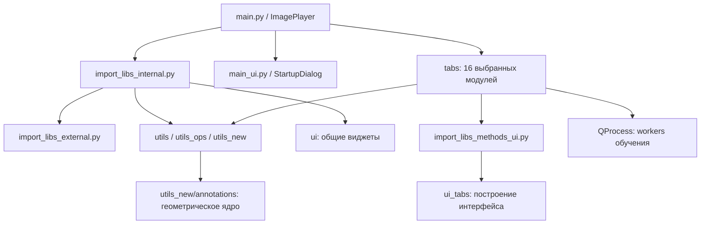
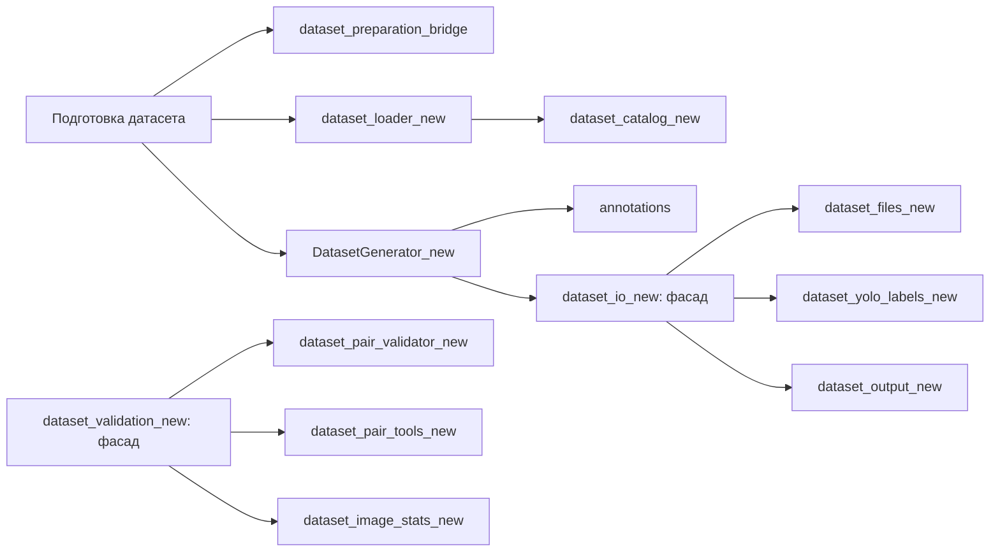

# Карта архитектуры и зависимостей

[Навигация](README.md) · [Полный справочник](Module_Reference.md) · [Проблемные связи](Duplication.md)

## Запуск и слои

`main.py` импортирует внутренний агрегатор **до** диалога выбора вкладок. `StartupDialog` содержит 16 записей `ALL_TABS`; выбор хранится в `QSettings("ThresholdResearcher", "TabSelector")`. `ImagePlayer._create_selected_tabs` импортирует выбранные классы и встраивает их `centralWidget()` в `QTabWidget`. Но выбор малого числа вкладок не устраняет начальную загрузку torch, ONNX Runtime и других пакетов из общего агрегатора.

`import_libs_external.py` импортирует библиотеки и Qt, печатает версии. `import_libs_internal.py` повторно экспортирует утилиты и виджеты. `import_libs_methods_ui.py` импортирует все функции сборки UI из `ui_tabs`. Поэтому прямой импорт `setup_*` из него загружает больше одного UI-модуля. Звёздочные импорты скрывают происхождение имён; каталог показывает прямые объявления импортов, а не доказанные вызовы каждой функции.

## Вкладки и рабочие цепочки

В таблице указаны ключевые рабочие зависимости. Полные списки прямых импортов и обратных потребителей приведены в справочнике; значительная часть утилит доступна вкладкам через агрегатор.

| ID → файл в tabs | UI в ui_tabs | Утилиты и выполнение |
| --- | --- | --- |
| `threshold` → `threshold_methods.py` | `threshold_methods_ui.py` | `utils_new.threshold_processing`: бинаризация; `annotation_processing`: объекты; `utils_new.morphology` и MorphologyWidget; `utils.image_io.LazyImageCache`; `AutoResearch`, пресеты |
| `gradient` → `gradient_methods.py` | `gradient_methods_ui.py` | `utils_ops.gradient_ops`, извлечение объектов из `segmentation_ops`, `GradientAutoResearch`, общий кэш изображений |
| `interactive` → `interactive_methods.py` | `interactive_methods_ui.py` | `utils_ops.interactive_ops`, старый `SmartGraphicsView`, морфология и экспорт разметки |
| `traditional_ml` → `traditional_ml_methods.py` | `traditional_ml_methods_ui.py` | `traditional_ml_ops`: признаки, суперпиксели, train/predict; сохранение joblib; общая сегментация |
| `deep_learning` → `deep_learning_methods.py` | `deep_learning_methods_ui.py` | `deep_learning_ops.create_segmentor`; параметры из `ui.DL_predict_settings`; изображения и маски |
| `reports` → `model_research.py` | `model_research_ui.py` | `utils.prepare`, `utils.analysis`, `utils.metrics_core`: фильтры, метрики, регрессия, ранжирование пресетов |
| `labeler` → `layout_dataset.py` | `layout_dataset_ui.py` | Прямые импорты `dataset_files_new`, `dataset_yolo_labels_new`, YAML/UNet/COCO/catalog; `SmartGraphicsViewNew`, обработка аннотаций |
| `test` → `viewing_dataset.py` | `viewing_dataset_ui.py` | Те же новые файловые службы; `DatasetReviewGraphicsView`, маски, редактирование и постобработка |
| `dataset` → `preparing_dataset_yaml.py` | `preparing_dataset_yaml_ui.py` | Агрегатор даёт **новые** `DatasetLoaderMixin`, `PairValidator`, `DatasetGeneratorThread`; bridge приводит пары и классы масок |
| `dataset_analysis` → `dataset_analysis.py` | `dataset_analysis_ui.py` | `dataset_analysis_logic`: статистика и фильтры; `dataset_audit_logic`: дубликаты, утечки, YOLO-аудит, эмбеддинги, отчёт |
| `sahi` → `slice_dataset_sahi.py` | `slice_dataset_sahi_ui.py` | Локальный `SliceWorker`, `sahi.slicing.slice_coco`, работа с файлами и split |
| `yolo_train` → `deep_learning_training.py` | `deep_learning_training_ui.py` | Виджеты `ui.DL_train_settings_*`; отдельные процессы YOLO, UNet, DeepLab |
| `yolo_demo` → `demo_ensemble_methods.py` | `demo_ensemble_methods_ui.py` | `utils.ensemble_utils`: YOLO + классические пресеты, собственные WBF/NMS и метрики |
| `yolo_sort` → `yolo_find_img.py` | `yolo_find_img_ui.py` | YOLO, фоновый поиск, список/миниатюры, копирование или перемещение |
| `yolo_aeb` → `yolo_test_aeb.py` | `yolo_test_aeb_ui.py` | `utils_aeb.yolo_aeb_utils`, `utils_new.annotation_processing`: YOLO-объекты, AE/VAE, кропы и карты ошибок |
| `settings` | `ui/settings_ui.py`, без ui_tabs | `utils.settings`: тема, палитра классов, размеры и шорткаты |

## Новая ветка обработки датасетов

`DatasetGenerator_new` разделяет движок генерации и QThread-обёртку. Геометрия работает с `Annotation`, `ImageSize`, `AnnotationSample`, `MaskEncoding`, а не с Qt. `annotations.adapters` переводит legacy-кортежи и результаты Ultralytics в каноническую форму; `geometry` проверяет и конвертирует геометрию; `transforms` применяет согласованные преобразования; `masks` растрирует классы; `augmentation` строит планы; `rendering` рисует результат. `dataset_io_new` и `dataset_validation_new` намеренно оставлены фасадами совместимости.

`dataset_files_new` читает изображения/индексные маски и содержит ленивый кэш. `dataset_yolo_labels_new` отвечает за YOLO TXT. `dataset_output_new` — за маски, YAML и COCO-выход. `dataset_catalog_new` хранит каталог источников, объединяет COCO и разрешает пути. `dataset_mask_preview_new` и `dataset_mask_diagnostics_new` готовят просмотр и статистику масок. `dataset_pair_validator_new` проверяет пары, `dataset_pair_tools_new` сканирует и конвертирует их, `dataset_loader_new` связывает загрузку с UI. `dataset_preparation_bridge` без Qt переводит старые пары `(image, aux)` в тройки `(image, label, mask)` и положительные значения маски в плотные классы.

`annotation_processing.py` — отдельный конвейер legacy-аннотаций: кропы, смещения, повороты, пересечения и маскирование; используется просмотрщиками и YOLO+AE/VAE. `morphology.py` — общий движок операций с явными размерами в пикселях. `threshold_processing.py` — выделенные пороговые алгоритмы, напрямую используемые пороговой вкладкой; при этом в `utils_ops.segmentation_ops` всё ещё есть параллельная реализация.

## Существующая старая ветка

`utils/image_io.py`, `yaml_io.py`, `annotation_converter.py`, `coco_io.py`, `coco_export.py`, `unet_io.py`, `unet_export.py`, `DatasetGenerator.py`, `dataset_validation.py`, `augmentation_base.py`, `augmentation_random.py`, `aug_utils.py` остаются в дереве и импортируются агрегатором. Они не стали автоматически ненужными после появления `utils_new`: старые вкладки продолжают работать с legacy-форматами. `utils.smart_view` обслуживает классические вкладки; `SmartGraphicsViewNew` и `DatasetReviewGraphicsView` — отдельные виджеты разметки и просмотра; пороговая вкладка также использует read-only `DatasetReviewGraphicsView`. Подмена одного другим без проверки событий и координат недопустима.

`utils_auto_research` содержит два перебора параметров и два диалога диапазонов. `utils.presets` хранит менеджеры пресетов. `utils.metrics_core` объединяет метрики для отчётов; `utils.prepare` готовит таблицы; `utils.analysis` ранжирует параметры. `ui` содержит общие панели навигации, морфологии, логов, настройки моделей и диалог проверки пар.

## Зависимости вне import-графа

- `tabs/deep_learning_training.py` запускает через `QProcess` и `sys.executable` файлы `utils_training/train_yolo_worker.py`, `train_unet_worker.py`, `train_DeepLabV3_worker.py`, передавая `--params` с JSON. Это отдельные процессы, не обычные импорты. Ветка альтернативного имени DeepLab предусмотрена, но файла `train_deeplabv3_worker.py` в дереве нет.
- SegFormer/SAM training — обработчики-заглушки; worker-файлов для них нет. `train_unet_worker_рабочий.py` не выбран GUI. `test_train_worker.py` — экспериментальный запуск обучения с абсолютными Windows-путями, не набор unit-тестов.
- `cluster/*.py` — самостоятельные CLI для YOLO-кропов, канонизации, извлечения/кластеризации эмбеддингов и классификации нового изображения. Они не являются вкладкой анализа датасета. Используйте `--help` конкретного скрипта, не переносите его параметры на GUI.
- `utils_aeb/auto-aeb*.py` — самостоятельные эксперименты обучения автоэнкодеров с локальными путями; GUI использует `yolo_aeb_utils.py`.
- `generate.py` — самостоятельный Qt-генератор коллажей. `rename_data.py` выполняет переименование на уровне модуля по жёстко заданному пути: не импортировать его для анализа.
- `settings/settings.json`, `settings/presets/*.json`, `settings/auto_settings/*.json` — файловое состояние. Модели, YAML, COCO, изображения и маски выбираются пользователем и отсутствуют в графе Python-импортов.

Каталог не объявляет модуль «мёртвым» только по отсутствию входящих импортов: он может запускаться как CLI, QProcess или быть фасадом внешнего API.
