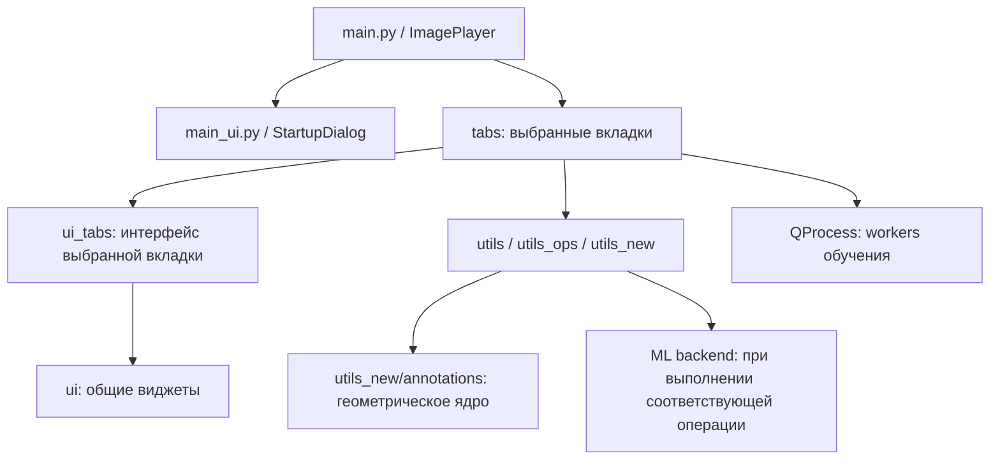
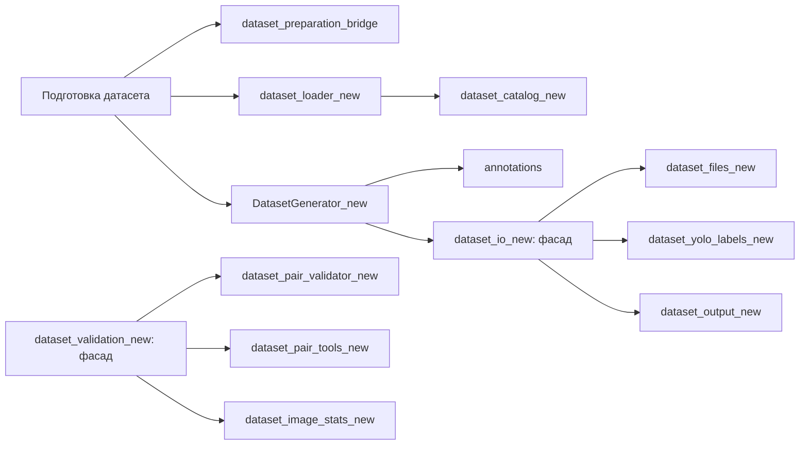

# Карта архитектуры и зависимостей

[Навигация](README.md) · [Полный справочник](Module_Reference.md) · [Проблемные связи](Duplication.md)

## Запуск и слои

`main` и диалог выбора не импортируют агрегаторы. `StartupDialog` содержит
16 записей `ALL_TABS`; `ImagePlayer` импортирует выбранные классы. Каждый
`QMainWindow` встраивается **целиком** с флагом `Qt.Widget` в `QTabWidget`.
Центральный виджет остаётся у своего окна, а `_tab_widgets` хранит ссылки на
те же встроенные окна. Qt владеет ими через стек вкладок. Нельзя извлекать
centralWidget и оставлять пустое окно дочерним у ImagePlayer: при показе
родителя оно может появиться поверх вкладок и перехватывать мышь.

Все исходники используют явные импорты из модулей-владельцев. Повторный import
не загружает другую версию библиотеки: объект находится в `sys.modules` данного
процесса. Три `import_libs_*.py` сохранены как ленивые compatibility facades через
`__getattr__`; их простой импорт не загружает Qt/ML. Старый `from facade import *`
внешнего клиента поддержан, но вынужденно разрешает все экспортируемые имена.
Внутри проекта такой способ запрещён архитектурным тестом.

Torch/ONNX в segmentor, YOLO авторазметки и Albumentations в аугментациях
импортируются в соответствующих операциях. Модуль определений AE/VAE содержит
классы-наследники `torch.nn.Module` и требует Torch при собственной загрузке;
базовая геометрия и обычные вкладки его не импортируют. Доступность optional
backend проверяется без их загрузки; реальные ошибки загрузки сообщаются при
выполнении операции. Проверка наличия пакета не доказывает его исправность.

Канонический автономный запуск — `python -m tabs.<имя>` из корня. Для прямого
запуска файла каждой вкладки предусмотрен короткий bootstrap корня до локальных
импортов. `get_project_root()` не меняет `sys.path` и не зависит от cwd.
Workers запускаются текущим `sys.executable`, с абсолютным путём и рабочим
каталогом проекта. Им не передаются объекты GUI и кеши родительского процесса.

## Вкладки и рабочие цепочки

В таблице указаны ключевые рабочие зависимости. Полные списки прямых импортов и обратных потребителей приведены в справочнике; все используемые утилиты импортируются явно.

| ID → файл в tabs | UI в ui_tabs | Утилиты и выполнение |
| --- | --- | --- |
| `threshold` → `threshold_methods.py` | `threshold_methods_ui.py` | `utils_new.threshold_processing`: бинаризация; `annotation_processing`: объекты; `utils_new.morphology` и MorphologyWidget; новая общая сессия/экспорт; AutoResearch без изменений |
| `gradient` → `gradient_methods.py` | `gradient_methods_ui.py` | `utils_ops.gradient_ops`; новые общие postprocessing, cache и Qt-сервисы; GradientAutoResearch без изменений |
| `interactive` → `interactive_methods.py` | `interactive_methods_ui.py` | `utils_ops.interactive_ops`; `ui.segmentation.interactive_view` для ROI/FG/BG; общие морфология/экспорт |
| `traditional_ml` → `traditional_ml_methods.py` | `traditional_ml_methods_ui.py` | `traditional_ml_ops`: признаки, суперпиксели, train/predict; сохранение joblib; новый eager I/O-адаптер и общие Qt/postprocessing |
| `deep_learning` → `deep_learning_methods.py` | `deep_learning_methods_ui.py` | `deep_learning_ops.create_segmentor`; параметры из `ui.DL_predict_settings`; новая сессия и общие Qt/postprocessing |
| `reports` → `model_research.py` | `model_research_ui.py` | `utils.prepare`, `utils.analysis`, `utils.metrics_core`: фильтры, метрики, регрессия, ранжирование пресетов |
| `labeler` → `layout_dataset.py` | `layout_dataset_ui.py` | Прямые импорты `dataset_files_new`, `dataset_yolo_labels_new`, YAML/UNet/COCO/catalog; `SmartGraphicsViewNew`, обработка аннотаций |
| `test` → `viewing_dataset.py` | `viewing_dataset_ui.py` | Те же новые файловые службы; `DatasetReviewGraphicsView`, маски, редактирование и постобработка |
| `dataset` → `preparing_dataset_yaml.py` | `preparing_dataset_yaml_ui.py` | Агрегатор даёт **новые** `DatasetLoaderMixin`, `PairValidator`, `DatasetGeneratorThread`; bridge приводит пары и классы масок |
| `dataset_analysis` → `dataset_analysis.py` | `dataset_analysis_ui.py` | `dataset_analysis_logic`: статистика и фильтры; `dataset_audit_logic`: дубликаты, утечки, YOLO-аудит, эмбеддинги, отчёт |
| `sahi` → `slice_dataset_sahi.py` | `slice_dataset_sahi_ui.py` | Локальный `SliceWorker`, `sahi.slicing.slice_coco`, работа с файлами и split |
| `yolo_train` → `deep_learning_training.py` | `deep_learning_training_ui.py` | Виджеты `ui.DL_train_settings_*`; отдельные процессы YOLO, UNet, DeepLab |
| `yolo_demo` → `demo_ensemble_methods.py` | `demo_ensemble_methods_ui.py` | `utils.ensemble_utils`: YOLO + классические пресеты, WBF/NMS и метрики; четыре новых read-only Qt-вида |
| `yolo_sort` → `yolo_find_img.py` | `yolo_find_img_ui.py` | YOLO, фоновый поиск, список/миниатюры, копирование или перемещение |
| `yolo_aeb` → `yolo_test_aeb.py` | `yolo_test_aeb_ui.py` | `utils_aeb.yolo_aeb_utils`, `utils_new.annotation_processing`: YOLO-объекты, AE/VAE, кропы и карты ошибок |
| `settings` | `ui/settings_ui.py`, без ui_tabs | `ui.settings_service`: тема, палитра классов, размеры и шорткаты |

## Новая ветка обработки датасетов

`DatasetGenerator_new` разделяет движок генерации и QThread-обёртку. Геометрия работает с `Annotation`, `ImageSize`, `AnnotationSample`, `MaskEncoding`, а не с Qt. `annotations.adapters` переводит legacy-кортежи и результаты Ultralytics в каноническую форму; `geometry` проверяет и конвертирует геометрию; `transforms` применяет согласованные преобразования; `masks` растрирует классы; `augmentation` строит планы; `rendering` рисует результат. `dataset_io_new` и `dataset_validation_new` намеренно оставлены фасадами совместимости.

`dataset_files_new` читает изображения/индексные маски и содержит ленивый кэш. `dataset_yolo_labels_new` отвечает за YOLO TXT. `dataset_output_new` — за маски, YAML и COCO-выход. `dataset_catalog_new` хранит каталог источников, объединяет COCO и разрешает пути. `dataset_mask_preview_new` и `dataset_mask_diagnostics_new` готовят просмотр и статистику масок. `dataset_pair_validator_new` проверяет пары, `dataset_pair_tools_new` сканирует и конвертирует их, `dataset_loader_new` связывает загрузку с UI. `dataset_preparation_bridge` без Qt переводит старые пары `(image, aux)` в тройки `(image, label, mask)` и положительные значения маски в плотные классы.

`annotation_processing.py` — отдельный конвейер legacy-аннотаций: кропы, смещения, повороты, пересечения и маскирование; используется просмотрщиками и YOLO+AE/VAE. `morphology.py` — общий движок операций с явными размерами в пикселях. `threshold_processing.py` — выделенные пороговые алгоритмы, напрямую используемые пороговой вкладкой; при этом в `utils_ops.segmentation_ops` всё ещё есть параллельная реализация.

## Существующая старая ветка

В `utils` осталось семь модулей с рабочими потребителями: image_io,
analysis, prepare, metrics_core, ensemble_utils, dataset_analysis_logic
и dataset_audit_logic. Старый набор генератора/валидации/I/O и алиасы
settings/presets удалены после проверки графа и строковых экспортов.
[Подробный аудит удаления](Utils_Removal_Audit.md).

Канонические Qt-виды находятся в `ui.image_view` и `ui.annotation_review_view`;
все потребители обновлены, прежних файлов-алиасов в utils_new нет.
Демонстрация ансамблей использует четыре DatasetReviewGraphicsView с векторными
рамками; `utils.smart_view` удалён после перевода единственного потребителя и
проверки отсутствия строковых экспортов. [Результат и проверки](Ensemble_View_Migration.md).
`utils_auto_research`
сохраняет уникальные алгоритмы до последнего этапа; запуск в UI временно отключён.

## Зависимости вне import-графа

- `tabs/deep_learning_training.py` запускает через `QProcess` и `sys.executable` файлы `utils_training/train_yolo_worker.py`, `train_unet_worker.py`, `train_DeepLabV3_worker.py`, передавая `--params` с JSON. Это отдельные процессы, не обычные импорты. Ветка альтернативного имени DeepLab предусмотрена, но файла `train_deeplabv3_worker.py` в дереве нет.
- SegFormer/SAM training — обработчики-заглушки; worker-файлов для них нет. `train_unet_worker_рабочий.py` не выбран GUI. `test_train_worker.py` — экспериментальный запуск обучения с абсолютными Windows-путями, не набор unit-тестов.
- `cluster/*.py` — самостоятельные CLI для YOLO-кропов, канонизации, извлечения/кластеризации эмбеддингов и классификации нового изображения. Они не являются вкладкой анализа датасета. Используйте `--help` конкретного скрипта, не переносите его параметры на GUI.
- `utils_aeb/auto-aeb*.py` — самостоятельные эксперименты обучения автоэнкодеров с локальными путями; GUI использует `yolo_aeb_utils.py`.
- `generate.py` — самостоятельный Qt-генератор коллажей с общим завершением Qt. `rename_data.py <folder>` переименовывает файлы только при явном CLI-запуске; импорт безопасен. Старые AE/VAE scripts создают каталоги и устанавливают seed только в main().
- `settings/settings.json`, `settings/presets/*.json`, `settings/auto_settings/*.json` — файловое состояние. Модели, YAML, COCO, изображения и маски выбираются пользователем и отсутствуют в графе Python-импортов.

Каталог не объявляет модуль «мёртвым» только по отсутствию входящих импортов: он может запускаться как CLI, QProcess или быть фасадом внешнего API.

## Контроль границ

`tests/test_import_architecture.py` проверяет отсутствие wildcard и обратных
импортов фасадов, циклов на верхнем уровне и загрузки ML базовыми модулями.
`tests/test_runtime_imports.py` проверяет независимые импорты вкладок, оба порядка,
обе точки входа, совместное создание 16 вкладок и `--help` четырёх workers.
`tests/test_dependency_installation.py` проверяет восстановление файлов cv2 после
удаления конкурирующего wheel и запрет скрывать прочие ошибки `pip check`.
План миграции и результаты: [Import_Architecture_Plan](Import_Architecture_Plan.md).

`runtime_policy.configure_ultralytics()` отключает автоматический pip стороннего
backend до загрузки YOLO, в том числе при ранее импортированном Ultralytics.
Эта политика применяется также в workers, CLI и старых фасадах. Устанавливать
дополнительные backend следует через install.py, а не во время инференса.

## Синхронизация с master 5043de7

Редактор и просмотр используют общие build_label_save_plan и
format_label_save_confirmation из dataset_yolo_labels_new. Карта чтения
_yaml_label_map отделена от _save_label_map; build_yolo_save_target_map
из dataset_yaml_new определяет канонический путь сохранения по split YAML.
Новые helpers не зависят от Qt. При объединении сохранены явные импорты,
автономные точки входа, runtime policy и общий Qt lifecycle ветки work.

## Windows и состояние загрузчика Torch

runtime_torch — нижний слой без Qt/NumPy. На Windows main и автономные вкладки
вызывают prepare_windows_torch до остальных нативных стеков; на Linux вызов
ничего не загружает. get_torch_runtime сохраняет успешный модуль либо ошибку
загрузки; detect_device использует это состояние без повторного импорта после
сбоя. Вкладка анализа различает недоступный Torch и CPU без CUDA.
Подробности и границы проверки: [Windows_Torch_DLL](Windows_Torch_DLL.md).

## Проверка реального попадания мыши

Регрессия test_method_tabs_keep_visible_window_and_dialog_parent проверяет
все пять вкладок методов: QApplication.widgetAt на позиции Load Images должен
вернуть кнопку, а не пустой QMainWindow. Клик отправляется через QWindow
верхнего окна; проверяются видимый владелец диалога, загрузка изображения и
изменение результата порогового метода при движении ползунка. Прямая отправка
clicked или QTest.mouseClick(button) обходит перекрывающие виджеты и сама по
себе не доказывает доступность элемента пользователю.

## Общие службы пяти вкладок сегментации

Общие загрузка/навигация, результаты, экспорт, гистограмма, действия пресетов
и log находятся в `ui/segmentation`. Чтение/resize и извлечение объектов — в
`utils_new/segmentation`, без Qt. Политика яркости `legacy-segmentation-v1`
сохраняется независимо от отмены старых форматов пресетов; четыре вкладки
остаются ленивыми, ML использует eager-адаптер.

Все пять используют `ui.morphology_ui.MorphologyWidget` и
`utils_new.morphology.apply_morphology`: close/open/erode/dilate в пикселях,
общая форма и изменяемый порядок. Нет процентных регуляторов и повторного
скрытого closing градиентного fill. Уникальные backend остаются в `utils_ops`.

Preset schema_version=2 проверяет `utils_new.segmentation.presets`; Qt binding
находится в `ui.segmentation.preset_bindings`. Настройки schema_version=1 хранит
`utils_new.settings_store`, QObject/сигналы — `ui.settings_service`.
Атомарный JSON I/O — `utils_new.json_store`. Старые схемы не конвертируются.
Ансамбли исполняют новую морфологию; относительный отчёт не может незаметно
создать старый пресет обратно. Автоподбор — последний отдельный этап.

[Пиксельный этап и проверки](Pixel_Morphology_Plan.md) · [Удаление утилит](Utils_Removal_Audit.md)
· [Общий план](Segmentation_Migration_Plan.md). `test_segmentation_shared` и
`test_pixel_morphology` защищают общие службы, маски/пресеты и новые границы.
