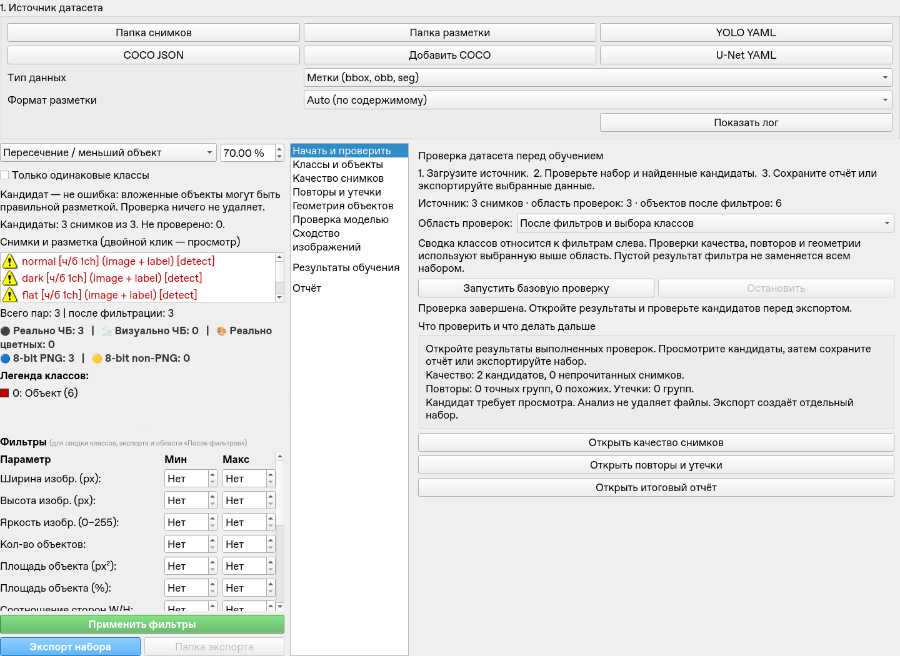

# Анализ датасета и проверка дублирующей разметки

Обновлено 21 ноября 2026 года. [План изменений](Dataset_Workspace_Plan.md).
Этот документ описывает текущий интерфейс; [предыдущий этап](Dataset_Audit_Refactor_Status.md)
содержит подробности форматов, экспорта и модельного аудита.

## Что исправлено

1. Предупреждения о перекрывающихся аннотациях доступны в просмотрщике,
   редакторе разметки, списке подготовки датасета и окне просмотра пары.
   Используется один виджет и одна геометрическая проверка.
2. Анализ датасета получил отдельную стартовую страницу, боковую навигацию,
   область проверок, сводку и объяснения следующих действий.
3. Исправлено воспроизведённое аварийное завершение при нажатии кнопки качества:
   Qt передавал `clicked(bool)` через `serialized_scan` в метод без аргументов.
   Исключение выходило из Qt-slot. Теперь этот контракт учтён, базовые проверки
   выполняются в фоне, ошибки вычисления/доставки результата показываются в UI.
4. Исправлена ошибка гистограмм для площадей, различающихся только погрешностью
   float: границы интервалов теперь конечны и различны.
5. Валидный четырёхточечный Segment и восстановленный порядок углов OBB больше
   не считаются повреждёнными только из-за информационного сообщения парсера.
6. Выполнен [аудит оставшихся потребителей utils](Legacy_Utils_Usage.md).
   Используемые старые модули сохранены.

## Как проверить перекрывающиеся аннотации

После загрузки снимков выберите параметры над списком объектов/пар:

| Параметр | Значение и назначение |
| --- | --- |
| Пересечение / меньший объект | `intersection / min(areaA, areaB)`. Находит и вложенные объекты с разными размерами. По умолчанию 70%. |
| IoU | `intersection / (areaA + areaB − intersection)`. Строже к различию размеров. |
| Порог, % | Пара считается кандидатом при значении **не меньше** порога. Диапазон 1–100%. |
| Только одинаковые классы | Проверять пары с одинаковым ID класса. По умолчанию выключено. |

Настройки сохраняются локально через QSettings `NeuroThreshold/annotation-review`
и восстанавливаются при создании следующего виджета. Уже открытые окна имеют
собственные контролы: изменение одного окна не переключает другое неожиданно.

- В объектах выводятся предупреждение, порог и подсказка с номерами соседей и
  фактическими процентами. Ошибки валидности разметки сохраняются отдельно.
- В просмотрщике/редакторе вкладка списка «Снимки» показывает все загруженные
  изображения, индикаторы и фильтр «Только кандидаты». Выбор строки открывает снимок.
- В подготовке/анализе индикатор добавляется к существующему списку пар, не
  заменяя текст, цвета классов и результаты других проверок. Подсказка отличает
  найденное перекрытие от ошибки чтения, при которой проверка невозможна.
- Двойной клик по паре открывает снимок с новым списком объектов и теми же
  параметрами проверки. Выбор объекта подсвечивает его геометрию.
- Изменения текущей разметки учитываются из памяти, даже до записи TXT.
  Старый фоновый результат не возвращает уже исправленный дубль.

Detect проверяется как прямоугольник, OBB и Segment — по вершинам в пикселях
исходного снимка. Используется существующий Shapely backend; без него для
выпуклых фигур применяется OpenCV, для невыпуклых — ограниченная растеризация
(приближённый результат). Перекрытие — **кандидат для просмотра**: вложенность
может быть корректной разметкой. Автоматического удаления нет.

## Как пользоваться анализом датасета

1. **Загрузите источник** в верхней группе: YOLO/U-Net YAML, COCO либо папку
   снимков и разметки. Для снимков без аннотаций выберите «Только изображения».
   Если автоопределение неоднозначно, укажите Detect/OBB/Segment явно.
2. В разделе **«Начать и проверить»** выберите весь набор либо результат
   применённых фильтров/выбора классов. Нулевой результат фильтра не подменяется
   всем датасетом. Пустые валидные TXT включены по умолчанию как отрицательные
   примеры; при необходимости это меняется слева.
3. Нажмите **«Запустить базовую проверку»**. Она последовательно проверяет
   качество снимков, точные/похожие повторы и утечки split, распределение объектов.
   Для режима без разметки геометрия пропускается. Модель/GPU не требуются.
4. Откройте **«Качество снимков»**. Таблица показывает размер, яркость, контраст,
   резкость и причины проверки; по умолчанию видны кандидаты. Двойной клик
   открывает исходный снимок с разметкой. Сняв фильтр кандидатов, можно посмотреть
   все измеренные снимки.
5. Откройте **«Повторы и утечки»**. Один клик выделяет группу в списке слева,
   двойной — открывает просмотр. Различайте повтор изображения и дублирование
   аннотаций внутри одного снимка: это разные проверки.
6. Сохраните **Markdown-отчёт** либо выполните **«Экспорт набора»** в отдельную
   папку. Проверки сами не удаляют и не переписывают исходники.

### Параметры качества и похожести

| Измерение | Правило по умолчанию | Ограничение |
| --- | --- | --- |
| Читаемость | Декодирование, непустые конечные значения | Битые снимки учитываются явно; они не становятся «хорошими» из-за пропуска. |
| Яркость | Среднее <40 или >215 | Шкала 0..255 после общей конвертации просмотра/фильтров, не физические единицы сенсора. |
| Контраст | Std <10 | Шкала 0..255; значение порога 0 выключает отбор по этому признаку. |
| Резкость | Var(Laplacian) <20 | Исходная сетка; зависит от разрешения/шума и типа изображений. Порог 0 выключает отбор. |
| Точный повтор | MD5 одинаковых байтов | Разные кодирования одного снимка не обязательно совпадут. |
| Похожий повтор | Hamming distance pHash ≤8 | Настраивается 0..64 бит: меньше — строже. Нужен ImageHash; отсутствие/ошибки показаны явно. |
| Утечка | Найденная группа присутствует в нескольких split | Проверяются обнаруженные группы, а не гарантируется отсутствие всех возможных утечек. |

Пороги качества настраиваются на странице; это эвристики для ручного просмотра,
а не оценка пригодности датасета без учёта предметной области. Например, однородный
фон может быть правильным отрицательным примером. Изменение порогов очищает
соответствующий результат и требует нового запуска. Подсказка `imgsz` в отчёте
опирается на медианное разрешение и кратность 32, ограничена 1280 и не оценивает
VRAM/AutoBatch. При отсутствии читаемых снимков масштаб не рекомендуется.

В отчёт включены область проверок, реальные применённые фильтры, пороги качества,
число непрочитанных снимков и до 100 кандидатов с причинами. Если поля фильтров
изменены после применения, это отмечается отдельно; результатам не приписываются
неприменённые значения. Остальные строки доступны в таблице интерфейса.

### Расширенные проверки

Сохранены отдельные страницы классов/площадей и дисбаланса, геометрии, аудита
и валидации YOLO, эмбеддингов/кластеризации, результатов обучения и отчёта.
Весов для базовых проверок не требуется; модельные операции загружают свои
зависимости по запросу. На Windows сохранена ранняя подготовка Torch перед Qt,
необходимая для порядка DLL; Linux-открытие анализа и базовая проверка не
импортируют Torch.

Качество/повторы/heatmap получают снимок входных данных и выполняются в фоне
с прогрессом/отменой. Смена данных, области или закрытие окна отменяют задачу
и блокируют доставку старого результата. Прерывание кооперативное между файлами:
вызов нативного декодера не прерывается посередине. Фильтрация классов/пар и
подготовка экспорта остались отдельными защищёнными синхронными операциями;
не следует считать все операции вкладки полностью асинхронными.

## Где находится код

Отдельная папка `analytics_dataset` не создавалась: она дублировала бы уже
перенесённые загрузчики и геометрию. Уникальные вычисления анализа добавлены в
`utils_new/dataset_audit`.

| Владелец | Содержимое |
| --- | --- |
| `tabs/dataset_analysis.py` | Сборка окна, подключение действий, состояние и закрытие |
| `ui/dataset_audit/workspace.py`, `source_page.py`, `page_*.py` | Навигация, страницы и параметры UI |
| `ui/dataset_audit/{session,selection,quality_controller,duplicates,spatial,models,embeddings,training_results,reporting}.py` | Qt-контроллеры по назначению |
| `ui/dataset_audit/{tasks,workers,lifecycle,presentation}.py` | Фоновые адаптеры, ревизии, обработка ошибок, таблицы/графики |
| `utils_new/dataset_audit/quality.py`, `scans.py` | Численные измерения и составная базовая проверка, без Qt |
| `utils_new/dataset_audit/annotation_review.py` | Фоновая проверка перекрытий файлов с учётом изменений в памяти, без Qt |
| `utils_new/dataset_audit/{objects,analysis,checks,splits,export,matching,jobs,atomic}.py` | Общая база анализа/аудита, экспорта и отчётов |
| `utils_new/annotation_processing.py` | Общая геометрия аннотаций и метрики перекрытия для всех потребителей |
| `ui/annotation_review.py` | Общий виджет кандидатов в дубли и индикаторы списков |
| `utils_new/{dataset_loader_new,dataset_files_new,dataset_labels_new,dataset_image_stats_new,dataset_validation_new}.py` | Общая инфраструктура подготовки/анализа: загрузка, I/O, парсер, нормализация и валидация |

Численные новые службы не импортируют Qt или модели. Старые 2700 строк окна и
1000 строк сборки UI разделены по ответственности; рабочие расширенные функции
сохранены, второй копии вычислительной базы не создано.

## Проверки

- Полный набор: **173 теста**, включая **25 проверок анализа/нового workspace**.
- Реальные Qt-нажатия качества/фильтра, основной сценарий, ошибка графика,
  смена области, отмена/закрытие и отбрасывание позднего результата.
- Предупреждения в обоих редакторах, подготовке и просмотре пары; порог,
  метрика, классы, изменение разметки в памяти, исходная геометрия.
- Читаемость/яркость/контраст/резкость, повреждённый снимок, гистограмма почти
  равных площадей; существующие контракты экспорта, split, масок и ML-аудита.
- Независимый импорт всех **200 исходных модулей** в отдельных процессах.
- Просмотр Qt-снимков экрана на синтетическом наборе с нормальным, тёмным и
  низкоконтрастным снимками. Снимки не являются пользовательским датасетом.

Проверки выполнены в Linux/offscreen. Пользовательское Windows-окружение и
анализ большого реального датасета в этой среде не запускались.
