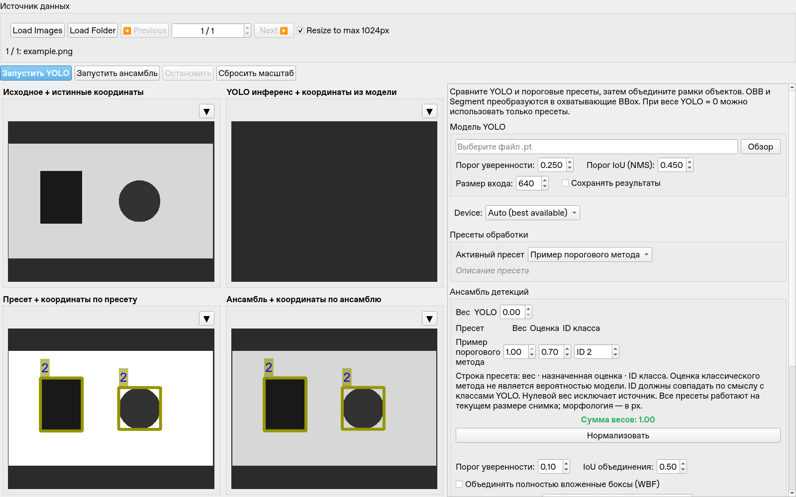
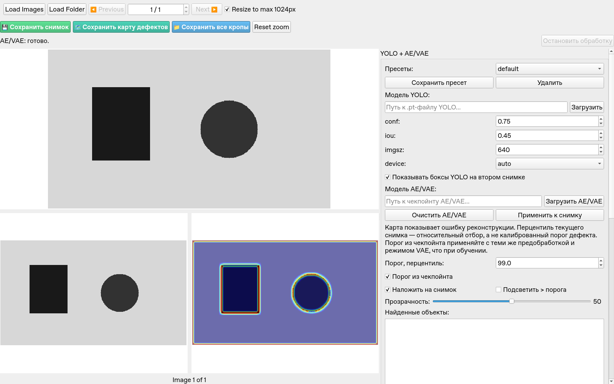

# Ансамбль, поиск YOLO и YOLO + AE/VAE: новые утилиты

Обновлено 21 ноября 2026 года. [План и приёмка](Legacy_Tabs_Migration_Plan.md).
Миграция трёх последних потребителей старой `utils` завершена.
[Проверяемый аудит](Legacy_Utils_Usage.md) показывает ноль исходных файлов,
потребителей и строковых экспортов удалённых модулей.

## Владельцы функций

| Область | Действующий модуль |
| --- | --- |
| Чтение, Unicode-пути, исходная глубина, нормализация, ресайз, lazy cache и запись | `utils_new/dataset_files_new.py` |
| Выбор/пакетная загрузка и прогресс Qt | `ui/segmentation/image_input.py` |
| Отображение numpy в Qt с копированием буфера | `ui/image_conversion.py` |
| Геометрия YOLO Detect/OBB/Segment, преобразования и карта ошибок | `utils_new/annotation_processing.py` |
| Общая обработка порогового пресета, детекции для ансамбля | `utils_new/threshold_processing.py` |
| Class-aware NMS/WBF и геометрия боксов | `utils_new/annotations/boxes.py` |
| Выделение объектов из маски | `utils_new/segmentation/postprocessing.py` и `annotation_processing.py` |
| Архитектуры и предобработка AE/VAE, проверенный численный инференс | `utils_new/segmentation/autoencoder.py` |
| Фоновое выполнение, отмена и защита доставки Qt | `BackgroundTask` в существующем `ui/segmentation/jobs.py` |

Новых файлов общих I/O, загрузчиков или ансамбля не создавалось. Единственный
новый файл утилиты — **перенос** уникального `utils_aeb/yolo_aeb_utils.py` в
`utils_new/segmentation/autoencoder.py`; исходный файл удалён. Дублирующие
реэкспорты геометрии и неиспользуемые импорты моделей во вкладке убраны.
Torch/архитектуры импортируются при модельной операции; на Windows сохранена
ранняя подготовка Torch перед Qt для корректного порядка DLL.

Удалены `utils/image_io.py`, `utils/ensemble_utils.py` и неиспользуемые записи
ленивого реестра `import_libs_internal.py`. Совместимые файлы-алиасы не оставлены.

## Демонстрация ансамбля

### Как пользоваться

1. Загрузите снимки. Переключатель ресайза задаёт **рабочий размер** снимка.
2. Выберите YOLO для модельного результата и пороговый пресет для сравнения.
   Предпросмотр пресета использует общий конвейер: параметры метода → инверсия
   → четыре операции морфологии в px → опциональная инверсия → объекты.
3. В каждой строке пресета задайте **вес, назначенную оценку и ID класса**.
   ID должен соответствовать смыслу класса YOLO. Например, классический метод
   поиска трещин нельзя бездумно смешивать с классом `person` модели COCO.
4. Выберите WBF или NMS, пороги и запустите ансамбль. Нулевой вес исключает
   источник. При весе YOLO `0` модель не требуется: можно объединять только
   классические пресеты. Кнопка остановки доступна и для YOLO, и для ансамбля.
5. Просмотрите рамки и текстовые координаты. Сохранение чистых пикселей или
   текущего вида доступно через контекстное меню графики.

### Исправления алгоритмов

- Сохранены исходные ID классов; разные классы не подавляются и не усредняются
  друг с другом. Старый код всегда возвращал класс `0`.
- NMS учитывает вес: `effective_score = score × weight / max(active_weights)`.
  Сортировка и порог результата используют эту оценку. Нулевой вес не даёт
  источнику участвовать. Классический NMS сам по себе не усредняет координаты.
- WBF усредняет координаты с весом `score × source_weight`; итоговая оценка —
  сумма таких вкладов, делённая на сумму **всех активных весов**, включая
  источники без найденного объекта. Пропуски снижают поддержку гипотезы.
- Источник не получает дополнительные голоса от повторяющихся рамок: перед
  fusion выполняется подавление дублей внутри источника; одна группа принимает
  не больше одной рамки каждого источника.
- Опция вложенности проверяет полное геометрическое включение бокса. Прежняя
  проверка по центру могла склеивать соседние объекты. Для NMS опция отключена.
- Назначенная оценка пресета теперь используется; раньше все рамки получали
  `1.0`, несмотря на значение в интерфейсе. Это **не калиброванная вероятность**.
- Проверяются веса, пороги и детекции; обрезка боксов к границам не создаёт
  объектов с нулевой площадью. Масштабирование всех весов одним коэффициентом
  не меняет результат (с точностью вычислений).

Все источники приводятся к Detect/BBox. YOLO OBB/Segment и полигональные
пресеты дают охватывающие прямоугольники; точная маска/ориентация в fusion
не сохраняется. Пресеты работают на текущем рабочем размере: px-морфология
при выключенном ресайзе даст другой результат. Это исследовательское
объединение рамок, а не обученная модель сегментации или доказательство
улучшения точности на реальном датасете.

Внешний `ensemble-boxes` не требуется. Загрузка и кнопки запуска/остановки
вынесены над снимками, параметры справа прокручиваются. Пользовательские веса,
оценки и ID сохраняются при перестроении строк в текущей сессии.

## Поиск снимков YOLO

1. Выберите корневую папку и веса; задайте ID целевого класса. Список классов
   модели читается в фоне, ручной ID остаётся доступен при ошибке метаданных.
2. Укажите confidence/IoU/imgsz, устройство, отступ и диапазон площади.
   **Отступ — в пикселях исходного снимка**, площадь — % площади исходного кадра.
   Нулевой критерий отключён; минимум больше максимума блокирует запуск.
3. Запустите поиск: результаты появляются по мере обработки. Сводка различает
   завершение, отмену, ошибку модели, непрочитанные снимки и ошибки обработки.
4. Отметьте снимки в списке или миниатюрах, отсортируйте и скопируйте/переместите
   в выбранную папку. Эти операции относятся **только к снимкам**, не к разметке.

Прежний загрузчик скрыто уменьшал всё до `640`, после чего пиксельный отступ
проверялся в уменьшенных координатах. Этот ресайз удалён; `imgsz` по-прежнему
управляет входом YOLO, а возвращённые рамки проверяются на исходной сетке.
Поддержаны выходы Detect/OBB/Segment через общий адаптер (критерии по BBox).
Декодирование больших оригиналов требует соответствующей оперативной памяти;
проверка не является тайловым поиском мелких объектов.

Ошибка конструктора YOLO больше не оставляет кнопки заблокированными.
Отмена кооперативная; частичные результаты можно сохранить после остановки.
Во время поиска перемещение/копирование и изменение параметров отключены.
Вложенный `processEvents` убран из прогресса.

Миниатюры декодируются в фоне через тот же reader, затем передаются в Qt как
массивы. Временные файлы и общая папка `tabs/temp_thumbs` больше не используются.
Выбор хранится в списке: появление миниатюры, переключение вида и сортировка
не сбрасывают отметки. Копирование/перемещение в папку самого источника
пропускает файл **до** подбора нового имени; больше не создаётся `name_1`
из-за такого действия. Совпадения других имён по-прежнему обходятся переименованием.

## YOLO + AE/VAE

1. Загрузите снимки и YOLO. Выберите объект для кропа/поворота/маскирования
   либо используйте снимок целиком. Преобразования и отображение работают с
   общими утилитами геометрии и графики.
2. Загрузите checkpoint `model` + `config` поддерживаемой архитектуры:
   Conv/ConvGN/U-Net/U-Net V2, варианты AE и VAE. Проверьте предобработку,
   размеры, каналы, keep-aspect/padding и дополнительный edge-канал.
3. Нажмите «Применить к снимку». YOLO и AE/VAE выполняются вне GUI; состояние
   и остановка находятся над снимками. При изменении входа старая карта очищается.
4. Порог берётся из checkpoint либо вычисляется как перцентиль в valid ROI.
   Настройте наложение/подсветку и сохраните результат или все кропы.

Исправлены проверка формы/числа каналов/NaN/Inf и обработка ошибок всего
численного этапа. Edge-канал используется как вход модели, но не сравнивается
с реконструкцией изображения. Выход `[1,C,H,W]` должен соответствовать
объявленным image/out-каналам и сетке модели. Некорректный checkpoint или
результат показывается как ошибка, а не выходит необработанным из Qt-slot.
Размеры Conv должны быть кратны 16, U-Net — 8; поддерживаются 1/3 image-канала.

Непрочитанный следующий файл больше не оставляет прежние снимок, объекты или
карту дефектов. Изменение рабочего снимка/объекта отменяет доставку предыдущего
расчёта. Сохранение снимка, карты и кропов использует общий Unicode-safe writer.

Семантика VAE старых checkpoint сохранена: по умолчанию используется sampling.
Явное `config.vae_use_mean=true` включает воспроизводимый posterior mean при
инференсе; обучающий режим остаётся стохастическим. Порог ошибки нужно
калибровать с **тем же режимом и предобработкой**. Перцентиль одного снимка
показывает относительные выбросы, а не доказывает наличие дефекта.

Синтетическая иллюстрация использует простой blur-reconstructor, а не
обученную диагностическую модель. Она показывает работу интерфейса и карты.
Загрузка/построение checkpoint пока выполняется отдельным синхронным действием;
в фон перенесены применения YOLO/AE и вычисление ошибки.

## Фоновые задачи и закрытие

`BackgroundTask` — QObject с executor/future и событием отмены, не QThread.
Закрытие не уничтожает работающий нативный поток после короткого `wait`.
Окно закрывает доставку задачи, устанавливает отмену и освобождает очередь.
Уже поставленные в Qt сигналы дополнительно отвергаются по текущему worker.
Каждое модельное окно имеет последовательный executor, исключающий одновременное
использование одной модели старой и новой задачей. `main.closeEvent` вызывает
тот же `shutdown_processing`, что и самостоятельное окно.

Отмена не прерывает нативный вызов YOLO/Torch посередине: поздний результат
отбрасывается, вычисление завершает текущий этап. CPU/GPU может оставаться занят
до завершения такого вызова. Это не обещание мгновенного завершения процесса.

Глобальный `sys.excepthook` больше не подменяется воркером ансамбля.
Перестройка строк весов использует обычные дочерние QWidget вместо ручного
жизненного цикла вложенных layouts. Qt-тесты уничтожают дерево виджетов до
завершения QApplication, как основной `ui.application.exec_window`.

## Проверки

- Полный набор **186 тестов**; 13 новых проверок миграции, включая реальные
  нажатия кнопок, фоновые операции, heartbeat GUI, отмену/закрытие, ошибки моделей,
  битый следующий снимок, миниатюры и выбор после сортировки.
- Восемь вариантов моделей (четыре архитектуры × AE/VAE) проверены на небольших CPU-тензорах без
  скачивания весов; для YOLO проверен контракт с контролируемыми результатами.
- Численные проверки классов, весов, WBF-голосов, пустых источников, вложенности,
  оценки пресета, исходного масштаба поиска и валидации входов.
- Независимый импорт всех **198 исходных модулей** без ошибок.
- AST-проверка отсутствия потребителей удалённых утилит и их строковых экспортов.
- Просмотр скриншотов всех трёх вкладок; устранено обрезание панелей параметров.

Среда проверки — Linux/offscreen/CPU. Пользовательские веса и Windows/CUDA
в этой среде не проверялись; качество ансамбля и AE на пользовательском датасете
следует оценивать по эталонной разметке.
