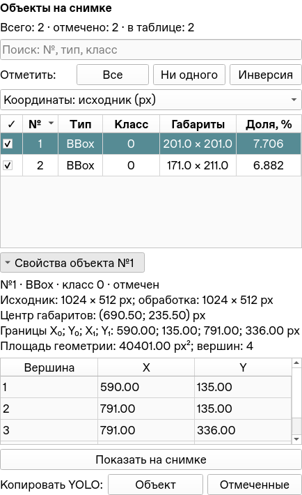

# Объекты на снимке: варианты и новый виджет

[Документация](README.md) · [Пять вкладок сегментации](Segmentation_Unification_Status.md)

12 ноября 2026 года. Область изменения — первые пять вкладок методов.
Общий read-only инспектор размещён в `ui/annotation_objects.py`; его можно
использовать и в других представлениях без зависимости от контроллера вкладки.
Редактор датасета сохраняет свои инструменты изменения геометрии.

## Рассмотренные варианты

| Вариант | Где удобен | Ограничение |
| --- | --- | --- |
| Карточки с миниатюрой и параметрами | Несколько объектов, визуальная проверка каждого | Большая высота, сложнее сравнивать и сортировать десятки объектов |
| Таблица и раскрываемые свойства | Много объектов, сравнение размеров, отбор, точные координаты | Детали одного объекта нужно раскрыть |
| Дерево по классам/типам | Многоклассовый датасет, групповые операции | Лишняя вложенность для двоичной сегментации с одним классом |

Выбрана таблица с раскрываемыми свойствами: краткая информация всегда видна,
все вершины и точные значения доступны в том же виджете. Отдельное поле
«Координаты отмеченных объектов» удалено вместе с обновлявшими его обработчиками.

Пример из приложения на искусственном снимке. Свойства раскрыты; в обычном
начальном состоянии они свёрнуты. Цвета и размеры шрифта задают глобальные настройки.

## Состав и поведение

- Счётчики всего/отмечено/видно в таблице; поиск по номеру, типу и ID класса.
- Колонки: отметка, постоянный номер в текущем результате, тип BBox/OBB/Segment,
  класс, габариты, доля площади снимка. Заголовки сортируют по численным значениям.
- «Все», «Ни одного», «Инверсия» применяются ко всему результату, включая
  скрытые поиском строки. Поиск управляет только таблицей, не экспортом и маской.
- Выбранная строка фокусирует объект на снимке. Отметки независимо включают
  отображение и сохранение; снятие отметки не удаляет объект или его свойства.
  Номер строки после сортировки не используется как ID объекта.
- Выбор объекта на снимке фокусирует его строку; если строку скрывает поиск,
  поиск очищается. Подпись на снимке содержит тот же номер и ID класса.
- «Показать на снимке» и двойной щелчок приближают отмеченный объект.
  Общий сброс масштаба возвращает обзор. Исключённый объект остаётся в таблице,
  а приближение для него недоступно.
- В раскрываемых свойствах: тип/класс/статус отметки, размеры исходника и
  обработки, центр габаритов, границы, площадь, число вершин и их таблица X/Y.
  Для OBB дополнительно показаны стороны и угол длинного ребра в исходнике.
- «Копировать YOLO → Объект / Отмеченные» копирует полный текст в буфер обмена.
  Порядок отмеченных объектов соответствует исходному результату, а не сортировке.
  Данные не обрезаются до первых вершин. Копирование не записывает файлы;
  «Сохранить разметку» сохраняет прежнее подтверждение и атомарную запись.

Свойства по умолчанию свёрнуты. Поиск, порядок сортировки и единицы сохраняются
при обновлении результата, фокус и отметки нового результата создаются заново.
Визуальные глобальные настройки сохраняют и фокус, и отметки без пересчёта маски.

## Единицы и смысл чисел

По умолчанию используются пиксели **исходного файла**, также доступны пиксели
обработки и нормализованные координаты 0…1. Размеры явно передаются из ImageFrame,
поэтому уменьшение изображения не подменяет исходные размеры. Таблица вершин
показывает непрерывные координаты границ с дробной частью.

«Габариты» — ширина и высота осевого охватывающего прямоугольника для любого типа.
«Центр» — центр этого прямоугольника, а не центр масс полигона. «Доля, %» —
площадь геометрии относительно снимка: у BBox/OBB площадь рамки, у Segment
площадь полигона. Это не число foreground-пикселей исходной маски.
Угол OBB всегда вычисляется в пикселях исходника, от оси X при направленной
вниз оси Y; нормализованные координаты не подставляются в расчёт угла.

Копирование и сохранение используют общий `serialize_yolo_labels`: BBox —
cx/cy/w/h, OBB — четыре угла, Segment — все вершины. Для четырёхточечного
Segment добавляется коллинеарная точка по действующему контракту writer,
чтобы повторное чтение в auto-режиме не превратило его в OBB.
Геометрия, классы и маска инспектором не редактируются.

## Реализация и проверка

Qt model/view отделяет полный набор объектов от сортировки/поиска и использует
полные индексы результата. `utils_new/annotations/object_info.py` вычисляет
измерения без Qt/настроек; `ui/segmentation/results.py` связывает инспектор
и вид изображения. Таблица вершин виртуальная: длинный контур не создаёт
тысячи виджетов или строк QTextEdit. Общая панель пресетов занимает две строки,
чтобы не растягивать правую колонку.

Пять регрессий `tests/test_annotation_objects.py` проверяют размеры/масштабы,
площадь геометрии, совпадение копируемого YOLO с writer, реальные клики по
сортированной таблице, фильтрацию/отметки/фокус, связь со снимком на всех пяти
вкладках, очистку и контур из 10 000 вершин. Существующие проверки общего UI
переведены на контракт инспектора. **Все 73 теста полной suite прошли** в Linux /
Qt offscreen, включая автономные запуски, графические слои других вкладок,
заморозку автоподбора и отсутствие лишнего predict при смене оформления.
Независимо импортированы 147 прикладных модулей: ошибок нет, training workers
не загружают Qt. Ruff, компиляция и 21 Markdown-файл с локальными ссылками проверены.
Код опубликован в `work`, коммит `d6ab7ee`.
Windows/CUDA и реальные нейросетевые веса здесь
не проверялись; численные алгоритмы сегментации этим изменением не менялись.
