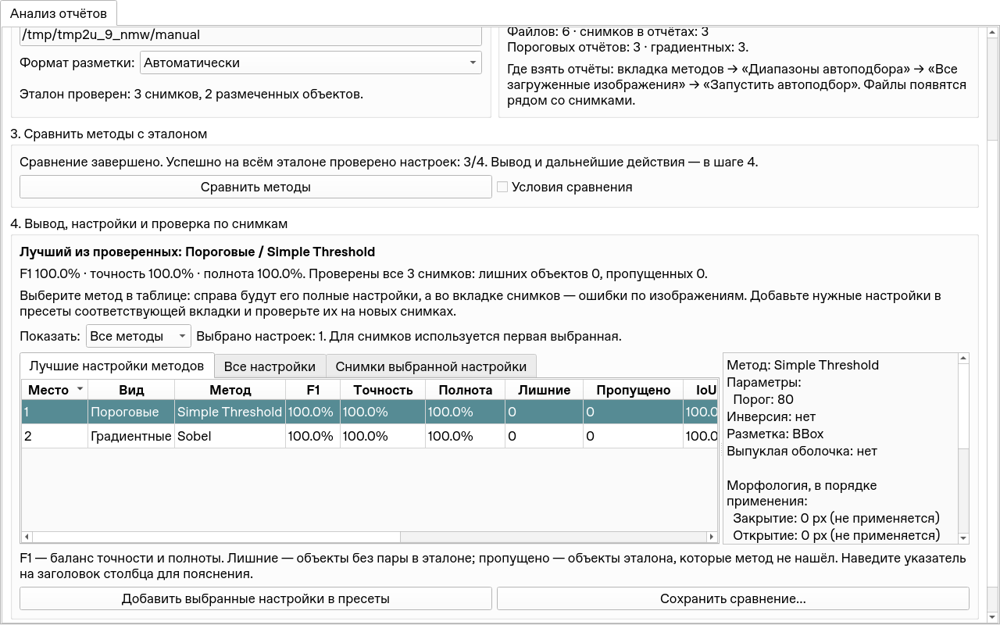

# Анализ отчётов: как выбрать метод для своего датасета

Основная задача вкладки — **выбрать из проверенных методов и полных настроек
те, которые лучше всего воспроизводят вашу правильную ручную разметку**.
Для этого нужны ручной эталон и результаты автоподбора на тех же изображениях.

## Четыре шага

### 1. Правильная ручная разметка

Нажмите «YOLO YAML…» или «Папка датасета…» и выберите свой эталон.
Обычная структура:

```text
my_dataset/
  images/train/001.png
  images/train/002.png
  labels/train/001.txt
  labels/train/002.txt
```

Можно хранить TXT рядом с изображениями. Можно выбрать папку только с TXT;
тогда в отчётах должны быть имена и исходные размеры всех соответствующих снимков.
Пустой существующий TXT обозначает снимок без объектов. Отсутствующий TXT
не означает отсутствие объектов и должен быть исправлен.

Начните с формата «Автоматически». Если размечены четырёхточечные Segment,
выберите «Segment — контуры» явно. BBox, OBB и Segment оцениваются по их
настоящей геометрии.

### 2. Результаты автоподбора

На вкладке пороговых или градиентных методов:

1. Загрузите изображения эталона.
2. Откройте «Диапазоны автоподбора», выберите методы и диапазоны параметров.
3. Отметьте «Все загруженные изображения» и нажмите «Запустить автоподбор».
4. Дождитесь готовых файлов рядом с исходными снимками:
   `*_full_report.txt` — пороговые; `*_gradient_report.txt` — градиентные.

В анализе нажмите «Добавить отчёты…» или «Папка отчётов…».
Поиск папки включает вложенные каталоги. Последующие добавления дополняют набор;
одинаковые пути повторно не загружаются. Счётчик показывает число файлов,
снимков и отчётов каждого вида. Можно начать с одного вида и добавить второй позже.
«Очистить» убирает входы из сравнения, сохраняя файлы на диске.

Для одного пресета нужны результаты на **всех** снимках эталона. Поэтому
используйте одинаковые диапазоны, режим разметки и условия обработки для всего
набора. Незавершённые partial-файлы и повреждённые отчёты не используются.
Старые CSV/Pickle с выборками строк не являются входными отчётами этого сценария.

### 3. Сравнить методы

Кнопка «Сравнить методы» становится доступной после выбора существующего эталона
и успешной загрузки отчётов. Над ней написано, какой шаг нужно выполнить дальше.
Полная проверка TXT, размеров и соответствия снимков выполняется при сравнении.

Начните с условий по умолчанию:

- IoU `0.50`: рамка/контур должны достаточно совпасть с эталоном.
- Учёт классов выключен: классические методы выделяют геометрию объектов.

В «Условия сравнения» можно повысить требуемое совпадение или потребовать
одинаковые class ID. Пояснения доступны при наведении на элементы.
Чтение и сравнение выполняются в фоне; «Остановить» отменяет текущую операцию.
Незавершённая оценка не становится результатом.

### 4. Вывод и сохранение настройки

После сравнения вкладка прокручивается к выводу. Здесь написано:

- какой метод оказался лучшим среди проверенных;
- его F1, точность, полнота, количество лишних и пропущенных объектов;
- что делать дальше либо какие данные нужно исправить.

В результатах есть три представления:

| Представление | Для чего нужно |
| --- | --- |
| «Лучшие настройки методов» | Быстро сравнить методы: по одной лучшей полной настройке каждого |
| «Все настройки» | Сравнить разные параметры, инверсии, морфологию и режимы разметки, увидеть неполное покрытие |
| «Снимки выбранной настройки» | Найти конкретные снимки с пропусками, лишними объектами, ошибками или отсутствующим вычислением |

Нажмите строку метода/настройки — справа появятся **все** параметры для её
повторения: метод, параметры, инверсия, разметка, оболочка, четыре операции
морфологии в пикселях и в правильном порядке, форма ядра и размер обработки.
Переключатель вида методов и фильтр проблемных снимков меняют только просмотр.
Результат сравнения от этого не пересчитывается и строки из оценки не удаляются.

«Добавить выбранные настройки в пресеты» сохраняет выбранные строки в хранилища
пороговой/градиентной вкладки. Для нескольких строк используйте Ctrl/Shift.
Откройте нужную вкладку методов и выберите сохранённое имя в списке пресетов.
Повторное добавление уже существующей настройки не создаёт её копию.
Проверьте результат на новых снимках, не участвовавших в подборе.

«Сохранить сравнение…» записывает всё в отдельную пустую папку:

- `summary.md` — понятная сводка и лучшие параметры каждого метода;
- `rankings.csv` и `best_methods.csv` — полный рейтинг и лучшие настройки;
- `image_details.csv` — результат каждого пресета на каждом снимке;
- `evaluation.json` — условия оценки и полные пресеты.

Пример интерфейса на 1280×800 после сравнения. Данные синтетические:
три снимка, два размеченных объекта; это иллюстрация интерфейса, не результат
для пользовательского датасета.



## Как понимать показатели

| Показатель | Практический смысл |
| --- | --- |
| F1 | Баланс точности и полноты; выше — лучше. 100% означает отсутствие FP/FN при выбранном IoU |
| Точность / Precision | Какая доля выделенных объектов правильная; высокая точность означает меньше лишних объектов |
| Полнота / Recall | Какая доля эталонных объектов найдена; высокая полнота означает меньше пропусков |
| Лишние / FP | Выделенные объекты, которым не нашлось пары в эталоне |
| Пропущено / FN | Объекты эталона, которым не нашлось пары в результате метода |
| IoU совпадений | Насколько точно совпали рамки/контуры найденных объектов |
| Снимков проверено | Успешно обработанные снимки / весь эталон |

Основной F1 считается по суммарным TP/FP/FN всего датасета.
Победителем может стать только настройка с успешным покрытием 100%.
Средний F1 по нескольким IoU — дополнительный показатель, не mAP.

## Если подходящего метода пока нет

| Что показывает вкладка | Что делать |
| --- | --- |
| Эталон или отчёты не выбраны | Выполнить указанный шаг; подсказка над кнопкой объясняет, чего не хватает |
| Победитель не определён, покрытие неполное | В «Все настройки» выбрать строку, затем открыть снимки и фильтр «Нет вычисления или ошибка». Дополнить автоподбор с одинаковыми диапазонами |
| Ошибка TXT, размера или соответствия | Исправить указанный файл/путь/формат и запустить сравнение снова |
| В эталоне нет размеченных объектов | Добавить положительные примеры. Одни отрицательные снимки позволяют проверить ложные срабатывания, но не выбрать метод обнаружения объектов |
| Полные результаты есть, F1 у всех равен нулю | Проверить формат разметки, инверсию, диапазоны, режим объектов и class ID, если включён их учёт |
| У нескольких пресетов одинаковый F1 | Посмотреть полноту, точность и IoU, затем проверить варианты на новых снимках |

Информация о незавершённой операции или ошибке остаётся в интерфейсе.
«Подробности выполнения» открывает журнал. Изменение входов или условий
сбрасывает устаревший вывод; поздние результаты отменённой задачи не применяются.

## Что очищено

Из вкладки убраны прежняя рабочая таблица и инструменты её преобразования:
удаление неудачных/пустых/идеальных строк, выборки, пороговый отбор по F1,
кластеризация, агрегация, оптимизация инверсии, отдельный «разнообразный топ»,
CSV/Pickle-обработка и скрытые переключатели старого рейтинга.
Они не участвуют в основном сценарии и больше не создают недоступные кнопки.

После проверки импортов и реестра удалены
`utils_new/autoreseach_utils/analysis.py`, `prepare.py`, `metrics_core.py`.
Нужные ансамблям `iou_xyxy`, `xyxy_to_yolo`, `yolo_to_xyxy` сохранены в общем
`utils_new/annotations/boxes.py`. Убраны их неиспользуемые соседи и старые
строковые экспорты. Сохранены численные конвейеры двух автоподборов,
геометрия, проверка полного покрытия и перенос всех параметров.
Старый дублирующий кеш осевых рамок больше не записывается в новые отчёты;
оценка использует исходные аннотации.

[Технические определения и ограничения](Report_Evaluation.md) ·
[План и приёмка](Report_Workflow_Plan.md).

Проверки: 123 теста и 168 независимых прикладных импортов прошли без ошибок.
Профильные сценарии включают отмену загрузки, отзывчивость GUI, выбор после
сортировки, неизменность оценки при фильтрах просмотра и видимость кнопок
после автоматической прокрутки к результатам.
