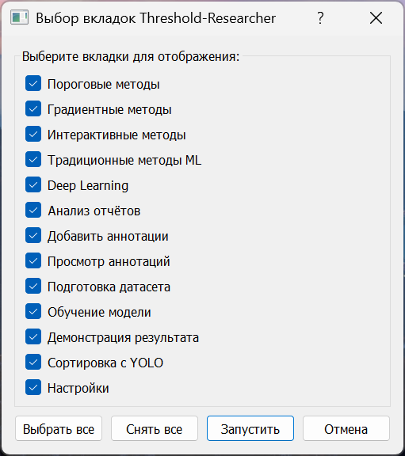
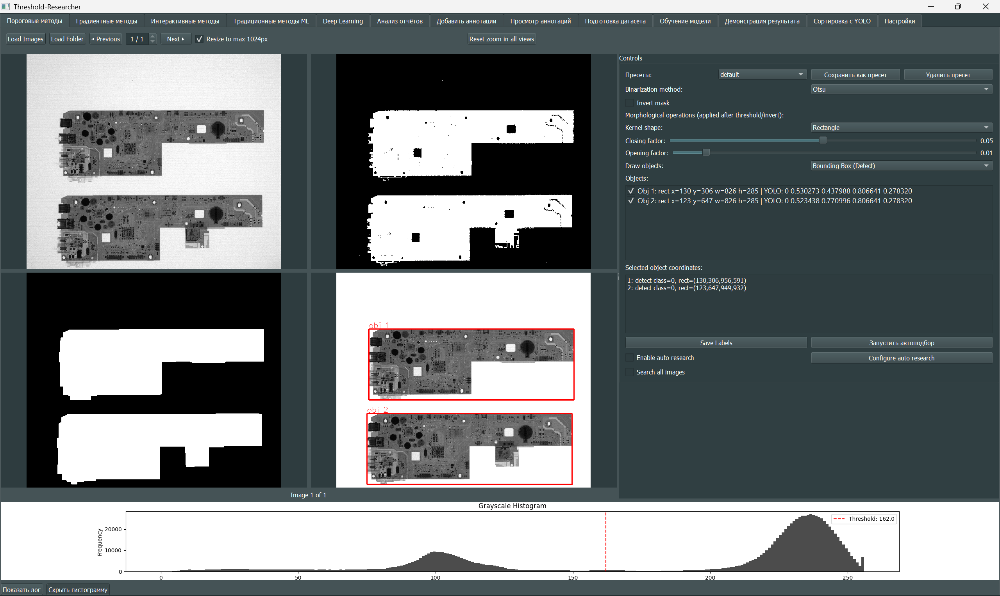

# Руководство пользователя

[Навигация](README.md) · [Установка и зависимости](Dependencies.md) · [Карта для разработчика](Architecture.md)

Threshold‑Researcher — локальное приложение PyQt5 для сегментации, разметки, подготовки и анализа датасетов. Оно работает с классическими методами и нейросетевыми моделями. Ниже описаны доступные пути в текущем коде; наличие формы настройки не всегда означает готовый алгоритм.

## Установка и первый запуск

Установите Python 3.12 и зависимости по [инструкции](Dependencies.md). Из корня репозитория выполните в выбранном venv:

```bash
python dependency_health.py --load
python main.py
```

В диалоге выберите вкладки и нажмите «Запустить». Для первого знакомства достаточно «Пороговые методы», «Градиентные методы» и «Просмотр аннотаций». Выбор запоминается через QSettings; пустой выбор завершает приложение. Библиотеки загружаются по зависимостям выбранных вкладок и операций; базовые настройки и пороговая вкладка не загружают Torch/ONNX через общий агрегатор.

Старые скриншоты сохранены для ориентира. Расположение элементов и набор параметров могли измениться.



## Подтверждение сохранения разметки

Во вкладках «Добавление аннотаций» и «Просмотр аннотаций» кнопки сохранения
показывают общий план записи: пути назначения, число новых и перезаписываемых
TXT, формат OBB. По умолчанию выбрано «Нет»; до подтверждения запись не начинается.

Для YOLO YAML путь чтения меток отделён от пути сохранения. Результат сохраняется
в `labels/train`, `labels/val` или `labels/test` корня датасета, с сохранением
вложенных путей. `valid` и `validation` при записи становятся `val`. Отсутствие
исходного TXT не мешает определить путь назначения. Коллизия выходных имён
останавливает подготовку плана.

`Save All` сохраняет только уже загруженные/изменённые аннотации; записи `None`
не записываются. При источнике U-Net подтверждение отдельно предупреждает:
сохраняются преобразованные YOLO TXT, исходные PNG-маски не изменяются.
Для COCO и U-Net проверяйте показанные пути конвертированных TXT; это не обратная
запись в исходный JSON или маски.

Изображения, аннотации и загруженные модели принадлежат конкретной вкладке.
Загрузка изображения в демонстрации YOLO не загружает его автоматически в
разметчик или другие вкладки. Если кнопка требует изображения/модель, сначала
загрузите их в этой же вкладке. Сообщение YOLO `no detections` означает успешный
инференс без найденных объектов при выбранных настройках, а не сбой загрузки DLL.

## Общий порядок работы

1. Откройте изображения кнопками `Load Images`/`Load Folder`; где предусмотрено, используйте YAML, COCO или U‑Net YAML для сопоставления изображений и разметки.
2. Выберите алгоритм или инструмент. Примените параметры к одному изображению и проверьте результат визуально.
3. При сегментации настройте инверсию, морфологию и представление объектов (bbox, OBB или контуры). Сохранение маски и сохранение координат — разные действия.
4. Нажмите `Save Labels` для текущего изображения или `Save All`, если такая кнопка есть. Переключение изображения и наличие разметки на экране сами по себе не подтверждают запись на диск.
5. Проверьте полученные файлы через вкладку просмотра или подготовки датасета.

Общие кнопки навигации переключают снимки; `Num+4`/`Num+6` назначаются предыдущему/следующему изображению там, где вкладка предоставляет эти действия. `Ctrl+0…9` меняет класс выделенного объекта во вкладках с таким обработчиком. Доступные операции зависят от вкладки, фокуса и режима просмотра. Не считайте все сочетания универсальными.

При загрузке с уменьшением изображения проверьте размер и координаты перед экспортом: входные кадры, отображаемая копия и индексная маска имеют разные роли. Новые службы разметки используют исходный размер при чтении/записи координат.

## Пороговые методы

Загрузите `Docs/test_image.png`. Выберите Simple Threshold, Otsu, Triangle, Adaptive Mean/Gauss, Niblack, Sauvola, ISODATA, Background Symmetry или Row Adaptive. Измените порог, окно или коэффициент нужного метода. Окна показывают исходник, бинаризацию, морфологию и аннотированный результат.

На всех пяти вкладках методов используется одна панель морфологии: закрытие, открытие, эрозия и расширение. Размеры задаются в пикселях; 0/1 выключают операцию. Выберите форму ядра, стрелками ↑/↓ задайте порядок. Пресеты сохраняют все четыре размера, форму и порядок; старые относительные пресеты не поддерживаются. Выберите представление объектов и сохраните разметку. Пустой результат тоже может сохраняться пустым TXT.

Автоподбор пороговых и градиентных методов временно отключён до отдельного последнего этапа перевода на пиксельные операции. Его прежние файлы/алгоритмы сохранены. Пороговая ветка формирует `*_full_report.txt`; градиентная — `*_gradient_report.txt`. Для оценки качества нужны соответствующие истинные аннотации. Результаты перебора разбираются во вкладке анализа отчётов.



## Градиентные методы

Выберите Sobel, Scharr, Laplacian, Canny, Prewitt, Roberts или Kirsch. Настройте параметры метода, последующую бинаризацию, заполнение/морфологию и представление объектов. Градиентная карта ещё не является разметкой: проверьте выделенные объекты и только затем используйте `Save Labels`. Пиксельная панель и схема пресетов общие с пороговой вкладкой; сами файлы пресетов раздельные. Морфология выполняется один раз перед фильтрацией/заливкой; скрытого повторного closing нет.

## Интерактивные методы

Выберите GrabCut, Watershed, Lazy Snapping, SuperCut, OneCut, Random Walker или Active Contour. Для методов с прямоугольником выделите область, для методов со штрихами укажите foreground/background соответствующими инструментами. Требования к вводу зависят от алгоритма; при смене изображения или метода проверьте актуальность меток.

Нажмите `Run Segmentation`, проверьте маску, при необходимости примените инверсию/морфологию и сохраните объекты. `Reset Input` очищает интерактивные подсказки. Эти методы не требуют весов нейросети.

## Традиционные методы ML

Загрузите изображения, выберите K‑Means, MeanShift, SVM, Random Forest, Decision Tree или XGBoost. XGBoost доступен только с дополнительным пакетом. Настройте признаки, нормализацию и, при необходимости, суперпиксели. Нажмите `Train Model`. Для классификаторов используется псевдоразметка, полученная из изображений; это не эквивалент обучения на вручную проверенной маске. У кластерных моделей выберите целевой кластер.

Примените `Segment Current Image`. При загрузке сохранённой модели согласуйте признаки с параметрами обучения; используйте предусмотренный сброс к настройкам модели. `Save Model`/`Load Model` работают с joblib/pickle-представлением. Сохранение модели не сохраняет разметку: для неё используйте `Save Labels`. Загружайте такие модели только из доверенного источника, поскольку десериализация pickle/joblib может выполнять код.

## Deep Learning: инференс

| Тип в форме | Реальный статус и вход |
| --- | --- |
| U‑Net | Реализован через segmentation_models_pytorch; нужны совместимые веса и метаданные обучения |
| DeepLabV3 / DeepLabV3+ | Реализован через segmentation_models_pytorch; конфигурация/метаданные должны соответствовать весам |
| YOLO-seg | Реализован через Ultralytics; `.pt`, задача определяется моделью. Для detect/OBB код может формировать маску через Otsu внутри объектов; это не нативная segmentation-маска |
| Custom ONNX | Реализован через onnxruntime; код ожидает конкретный NCHW-вход и масочный выход, произвольный ONNX не гарантированно совместим |
| SegFormer | Не реализован: фабрика выбрасывает NotImplementedError |
| SAM | Загрузка и предсказание — заглушки; установка segment-anything этого не меняет |

Загрузите изображения, задайте тип, веса и параметры (`conf`, IoU, размер входа, порог маски — по выбранной модели). Выберите устройство, нажмите обработку текущего изображения. Проверьте размер и ориентацию результата; затем применяйте постобработку и сохраняйте метки. Для U‑Net/DeepLab используйте сопутствующий `*_meta.json` из своего обучения и поддерживаемый режим resize. Указание расширения `.pth` само по себе не гарантирует совместимость архитектуры.

## Обучение моделей

Рабочие ветки GUI: **YOLO, U‑Net, DeepLabV3+**. Формы SegFormer и SAM пока только выводят параметры/сообщение; обучение ими не запускается.

1. Подготовьте отдельный датасет и проверьте классы/маски.
2. Для YOLO укажите YAML и совместимую задачу модели (detect/segment/OBB). Для U‑Net — пары изображений и индексных масок; для DeepLab — ожидаемую worker-скриптом VOC-структуру (`JPEGImages`, `SegmentationClass`, `ImageSets`). Подготовка U‑Net YAML не заменяет VOC-конвертацию. Для конвертации есть отдельный `utils_training/yolo2voc.py`.
3. Выберите папку проекта и имя эксперимента, число эпох, batch, размер входа, устройство, loss/оптимизатор и аугментации, предусмотренные выбранной формой.
4. Запустите обучение. GUI создаёт отдельный процесс тем же Python и передаёт JSON-параметры. Смотрите лог процесса; открытая форма не подтверждает наличие дополнительной библиотеки.
5. Сначала выполните короткий эксперимент на небольшом наборе. Проверьте пути результатов, веса и метаданные. Названия и состав артефактов зависят от worker; YOLO обычно пишет `weights/best.pt` и `last.pt`.

Кнопка остановки завершает процесс по механизму конкретной ветки; не рассчитывайте на гарантированное сохранение нового checkpoint при принудительном завершении. `utils_training/test_train_worker.py` содержит локальные Windows-пути и не предназначен для запуска как автоматический тест на вашем датасете без настройки.

## Анализ отчётов

Откройте папку с результатами автоподбора. Фильтруйте некорректные параметры, пустые/аномальные предсказания, дубликаты и избыточную сегментацию. Выполните расчёт метрик, кластеризацию параметров и при необходимости open/close, агрегацию и оптимизацию invert. Затем запустите анализ модели или глобальный подбор лучших методов. Отчёты с ненулевыми процентными ядрами нельзя автоматически сохранить в новый пресет без рабочего размера кадра: задайте пиксельные параметры на вкладке метода.

Название кнопки «Расчет meanAP» не означает, что все полученные поля — стандартный COCO mAP: код вычисляет в том числе `mean_f1`, `f1_50`, качество IoU истинных совпадений. Интерпретируйте поля по `utils.metrics_core`/`utils.prepare`. Регрессионный подбор и глобальное ранжирование — разные режимы.

## Добавление аннотаций

Загрузите изображения и, при наличии, метки/YAML/COCO/U‑Net YAML. Выберите инструмент **Box**, **OBB**, **Segment** или **Segment Line**. Создайте объект и задайте класс. Для изменения геометрии используйте режим редактирования и выделенный объект; инструменты полигона и OBB имеют собственную последовательность точек. Навигация, zoom и выделение не равнозначны редактированию.

Доступны `All Box → OBB`, авторазметка YOLO с настройками confidence/IoU/imgsz, постобработка объектов и проверки аннотаций. Сначала проверьте результат авторазметки на одном изображении. `Save Labels` пишет текущую разметку, `Save All` — уже загруженные/изменённые аннотации по разрешённым путям меток; ещё не прочитанные записи с `None` пропускаются. При загрузке YAML пути могут вести в отдельное дерево `labels/`, а не рядом с картинкой. Проверьте лог записи.

## Просмотр аннотаций

Загружайте изображения с TXT, YAML, COCO либо пары U‑Net. `Load Masks` добавляет маски; настройте наложение. Можно переключать вид исходника/объектов, отступ кропа, скрывать рамки и подписи, менять отображаемую заливку и применять предусмотренные операции над аннотациями.

Просмотр использует `DatasetReviewGraphicsView`: щелчок выделяет, перетаскивание панорамирует; перетаскивание мышью **не редактирует геометрию**, как в Labeler. Удаление/смена класса выполняются предусмотренными действиями списка/панелей. Для правки точек перейдите в «Добавление аннотаций». `Save Labels`/`Save All` явно записывают изменения. Скрытие рамок и заливка отображения не означают изменения исходного файла изображения.

## Подготовка датасета

1. Выберите вход: **метки**, **маски** или **только изображения**. Загрузите папки, YOLO YAML, COCO (включая `+ Add COCO`) или U‑Net YAML. Проверьте список пар и ошибки валидации.
2. Укажите входной формат аннотаций. Для четырёхточечного полигона выбирайте `segment` явно: девять токенов могут интерпретироваться как OBB в автоматическом режиме.
3. В таблице классов выберите включаемые классы, имена и соответствие новым плотным ID. В режиме масок значение пикселя **0 — фон**, положительные значения сопоставляются выбранным классам.
4. Задайте размер/resize, каналы, цвет полей, фильтр площади и включение пустой разметки. Конвертация «В Ч/Б», «В RGB» перезаписывает выбранные исходные изображения; «В 8-бит PNG» преобразует изображения, не маски.
5. Задайте аугментации и множитель. Для воспроизводимости включите фиксированный seed. Включите группировку аугментаций по исходнику, чтобы варианты одного снимка не попадали в разные split.
6. Настройте train/val/test и выходы: YOLO TXT с нужным типом/OBB-представлением, индексные PNG-маски, U‑Net YAML, COCO. Не все выходы обязательны одновременно.
7. `Save YAML` выбирает выходное место; выполните `Generate Dataset` и дождитесь завершения. Для пробы используйте новую пустую папку. По умолчанию движок допускает merge с существующим выходом — это не гарантированная очистка старых файлов.
8. Проверьте количество файлов, несколько меток и split. `images/{split}`, `labels/{split}`, `masks/{split}` создаются в зависимости от выбранных выходов. Основной YOLO YAML — `data.yaml`, U‑Net — `masks_data.yaml`; COCO создаётся для соответствующих split.

Выходная индексная маска: фон `0`, класс `0` → пиксель `1`, класс `1` → `2` и т. д. Это не RGB-цвета палитры. Режим «удалить исходники после успешной генерации» удаляет обработанные исходные файлы; оставьте его выключенным, если перенос данных не является вашей целью.

## Анализ датасета

Загрузите папку/YAML/COCO/U‑Net. Используйте статистику классов, размеров/разрешения и яркости, фильтры и экспорт отобранного набора. Кнопка «Создать новый датасет» предназначена для отдельного результата, а не просто для скрытия строк.

Дополнительные панели: анализ качества, точные/похожие дубликаты и утечки между split, тепловая карта распределения объектов, валидация и аудит YOLO-модели, кластеризация CLIP-эмбеддингов, просмотр результатов обучения, генерация Markdown-отчёта. Для похожих дубликатов нужен ImageHash, для эмбеддингов — доступный CLIP backend и веса; UMAP/HDBSCAN имеют fallback в соответствующих ветках. Смотрите [таблицу зависимостей](Dependencies.md#дополнительные-возможности).

Точный дубликат, визуально похожая картинка и утечка между train/val/test — разные признаки. Проверьте пары вручную до удаления. Для аудита модели сначала загрузите совместимые веса и корректный validation YAML. Для изображений результатов обучения используется `TrainingImageLabel` из `ui_tabs.dataset_analysis_ui`; ошибочный fallback импорта устранён.

## SAHI: нарезка датасета

Установите `sahi`, выберите входной датасет и параметры тайлов/перекрытия во вкладке «SAHI Нарезка датасета». Укажите отдельную выходную папку, запустите нарезку и проверьте изображения и обрезанные аннотации. Код использует `sahi.slicing.slice_coco`; готовность вкладки без пакета не означает готовность операции slicing. Проверяйте формат и сопоставление классов при конвертации.

## Демонстрация ансамбля

Загрузите изображения, модель YOLO и пресеты классических методов. Сравните результаты отдельно, затем настройте веса источников, confidence/IoU и WBF либо NMS и запустите ансамбль. Эти операции реализованы в `utils.ensemble_utils`; отдельный пакет `ensemble-boxes` в текущем коде не требуется. Согласуйте смысл классов модели и пресетов. Объединение детекций не является обучением новой модели.

## Сортировка с YOLO

Выберите корневую папку поиска, модель, целевой класс и пороги. Запустите рекурсивный поиск; просмотрите список или миниатюры, отметьте результаты и выберите папку назначения. «Копировать» сохраняет исходники, «Переместить» меняет их расположение. Перед переносом проверьте, сохраняется ли структура вашего датасета и соответствие соседней разметке.

## YOLO + AE/VAE

Загрузите изображения и модель YOLO. Проверьте найденные объекты; настройте кропы, смещения, повороты/отражения и маскирование. При наличии совместимых весов загрузите AE/VAE и примените к снимку; карта дефектов основана на выбранной модели и обработке объектов. Можно сохранить снимок, карту дефектов и все кропы.

Вкладка не обучает AE/VAE. Скрипты `utils_aeb/auto-aeb*.py` — отдельные эксперименты с собственными архитектурами/путями; произвольные `.pth` не гарантированно загрузятся. Без модели реконструкции не следует интерпретировать пустую карту как отсутствие дефектов.

## Форматы данных

| Формат | Содержание |
| --- | --- |
| YOLO detect TXT | `class cx cy w h`, координаты нормализованы на размер изображения |
| YOLO OBB TXT | `class x1 y1 x2 y2 x3 y3 x4 y4`; также поддерживается явно выбранный xywhr-вариант |
| YOLO segment TXT | `class x1 y1 ... xn yn`, не менее трёх точек |
| Legacy API | `('detect', cls, cx, cy, w, h)` либо `('obb'/'segment', cls, flat_points)`; координаты нормализованы |
| Каноническое ядро | `Annotation(kind, class_id, points_px)`; непрерывные пиксельные координаты границ, `ImageSize(width, height)` |
| Индексная маска | Одноканальный массив ID; в новом экспорте фон 0 и offset классов 1 |
| COCO | JSON с изображениями, категориями и геометрией; поддержка конкретной геометрии проверяется импортёром |
| YAML | Пути к split/изображениям/меткам или маскам и имена классов; YOLO и U‑Net YAML не взаимозаменяемы |

Нельзя различить OBB и четырёхточечный segment только по числу чисел. Для xywhr сверяйте соглашения угла и нормализации с выбранным читателем. При преобразовании невыпуклого полигона в bbox/OBB форма может измениться; проверки и политики потерь есть в новом геометрическом ядре.

## Настройки и сохранение

Вкладка «Настройки» меняет тему, акцент, цвета, палитру классов, размеры шрифта/линий в пикселях и параметры навигации. Глобальные значения хранятся в `settings/settings.json`, пресеты — в `settings/presets/`, диапазоны автоподбора — в `settings/auto_settings/`. Текущие глобальные настройки имеют schema_version=1, пресеты пяти методов — schema_version=2 с kind и morphology.units=px. Комплектные файлы обновлены; прежние форматы не преобразуются при открытии. Неверный файл не перезаписывается автоматически. JSON записывается атомарно. Они находятся внутри репозитория и могут изменяться приложением. Выбор вкладок хранится отдельно в QSettings. Для переноса рабочего места учитывайте оба источника.

## Проверка работоспособности

При обновлении документации выполнены:

- независимое создание и отображение всех 16 вкладок в Linux/Qt offscreen;
- загрузка и отображение `test_image.png`, пять пороговых и два градиентных метода;
- CPU-операция torch и `pip check`;
- статический разбор 128 модулей и проверка ссылок документации.

Дополнительно проверены: roundtrip legacy↔каноническая аннотация, площадь/кодирование маски, resize и генерация одного искусственного снимка в YOLO TXT, PNG-маску, YOLO/U‑Net YAML и COCO. Генерация завершилась без пропусков и сохранила исходники. Эти проверки не означают, что выполнены обучение, скачивание весов, оценка качества всех моделей или проверка всех действий мышью. Для первого запуска на ваших данных обработайте один снимок, сохраните метки и загрузите их обратно. Для генерации начните с нового каталога и малого набора; для обучения — с короткого эксперимента.

При `ModuleNotFoundError` проверьте Python активного venv и таблицу дополнительных пакетов. При Qt-ошибке проверьте графический сеанс, Qt platform plugins и системные библиотеки; offscreen подходит только для автоматизации. При неверной разметке сначала проверьте формат, исходный размер, class mapping и offset маски, затем настройки алгоритма.

Архитектура импортов и установка актуализированы: используйте [профили и диагностику](Dependencies.md),
а для автономного запуска вкладок — `python -m tabs.threshold_methods` из корня
или прямой путь `python tabs/threshold_methods.py`. Повторные обычные импорты
безопасны внутри одного процесса; процессы обучения имеют отдельные кеши.
