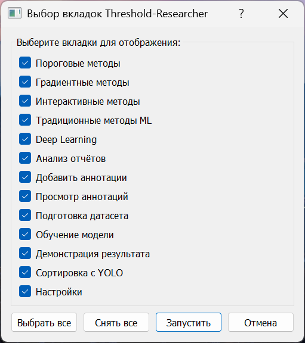
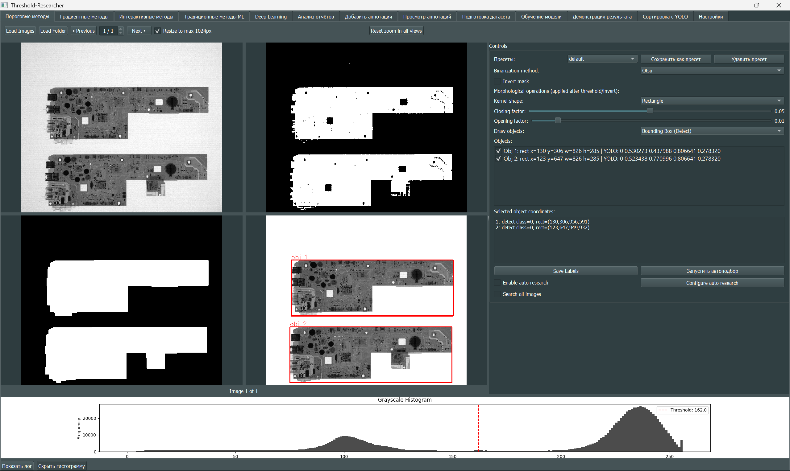
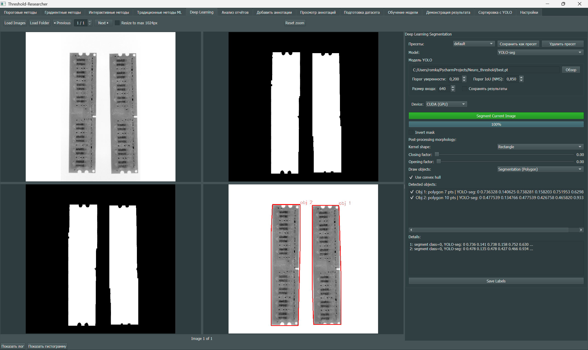

# Threshold‑Researcher

**Threshold‑Researcher** — это десктопное приложение на PyQt5 для исследования и применения методов сегментации изображений. Программа объединяет классические алгоритмы (пороговые, градиентные, интерактивные), методы машинного обучения, глубокое обучение (YOLO, UNet, DeepLabV3 и др.), а также мощные инструменты для работы с датасетами: ручная разметка, просмотр аннотаций, подготовка датасетов, обучение моделей и анализ результатов.

## Основные возможности

| Модуль | Что делает |
|--------|------------|
| **Пороговые методы** | Бинаризация (Simple, Otsu, Adaptive, Niblack, Sauvola, ISODATA, Row Adaptive), морфология, авто‑исследование параметров. |
| **Градиентные методы** | Выделение границ (Sobel, Scharr, Laplacian, Canny, Prewitt, Roberts, Kirsch), бинаризация, заливка контуров. |
| **Интерактивные методы** | GrabCut, Watershed, Lazy Snapping, SuperCut, OneCut, Random Walker, Active Contour — сегментация с помощью прямоугольника или штрихов. |
| **Традиционные ML** | K‑Means, MeanShift, SVM, Random Forest, XGBoost, Decision Tree. Обучение на псевдо‑разметке, выбор признаков, суперпиксели. |
| **Deep Learning (инференс)** | U‑Net (с метафайлом), YOLO‑seg, DeepLabV3+, Custom ONNX. Загрузка моделей, предсказание масок. |
| **Обучение моделей** | YOLO (detection/segmentation/OBB), U‑Net, DeepLabV3+. Автоматический подбор batch, early stopping, сохранение графиков и метрик. |
| **Разметка датасета (Labeler)** | Ручное создание аннотаций (detect, obb, segment), редактирование (перемещение, вращение, изменение точек), сохранение в YOLO‑формат. |
| **Просмотр аннотаций** | Визуализация разметки, масок, изменение классов, удаление объектов, загрузка YAML‑датасетов. |
| **Подготовка датасета** | Из изображений, аннотаций или масок: ресайз, аугментации (флип, повороты, shear), разбиение train/val/test, генерация data.yaml. |
| **Анализ отчётов** | Загрузка результатов авто‑исследования (`*_full_report.txt`), фильтрация, расчёт meanAP, кластеризация параметров, регрессия, отбор топ‑5 пресетов. |
| **Ансамблирование (демонстрация)** | Объединение детекций YOLO и пресетов через WBF/NMS, визуальное сравнение. |
| **Поиск изображений по классу** | Рекурсивный поиск файлов, содержащих заданный класс, с помощью YOLO; копирование/перемещение отобранных файлов. |
| **Настройки** | Тёмная/светлая тема, акцентный цвет, цвета аннотаций, размер шрифта и толщина линий. |

## Краткое руководство пользователя

### Первый запуск
1. Установите зависимости: `python install.py --torch cpu` в активном venv.
2. Запустите: `python main.py`.
3. В диалоге выбора вкладок отметьте нужные модули (например, «Пороговые методы», «Градиентные методы», «Анализ отчётов») и нажмите «Запустить».



### Типичный рабочий процесс
1. **Загрузите изображения** через панель навигации (Load Images / Load Folder).
2. **Выберите метод** (бинаризация, градиенты, интерактивный, ML или DL).
3. **Настройте параметры** (порог, размер окна, морфологию, признаки модели и т.д.).
4. **Выполните обработку** – кнопка «Segment Current Image», «Run Segmentation» или «Запустить ансамбль».
5. **Просмотрите результаты** в нескольких окнах (оригинал, маска, аннотированное).
6. **Отредактируйте аннотации** при необходимости (в Labeler или Viewing Dataset).
7. **Сохраните аннотации** кнопкой «Save Labels» — они запишутся в файл `.txt` рядом с изображением в YOLO‑формате.



### Для автоматического подбора параметров (пороговые/градиентные)
- Включите **Enable auto research**, настройте диапазоны через **Configure auto research**, нажмите **Запустить автоподбор**. Результат — текстовый отчёт `*_full_report.txt` в папке изображения.

### Для анализа результатов авто‑исследования (вкладка «Анализ отчётов»)
- Выберите папку с отчётами → нажмите **Расчет meanAP** → **Кластеризация параметров** → **Запустить анализ модели**. Получите топ‑5 пресетов для каждого метода.

### Для обучения модели (YOLO / U‑Net / DeepLabV3+)
- Подготовьте датасет (структура подсказана в виджете).
- Укажите папку датасета и папку проекта.
- Настройте гиперпараметры (эпохи, batch, аугментации).
- Нажмите **Запустить обучение** — процесс идёт в отдельном потоке, прогресс виден в логе.



### Для ручной разметки (Labeler)
- Загрузите изображения → включён режим **Drawing Mode** → рисуйте прямоугольники.
- Выделяйте объекты (Ctrl+ЛКМ) для редактирования (перемещение, изменение размеров, вращение OBB).
- Двойной клик по объекту в списке — изменить class ID.
- Нажмите **Save Labels** для сохранения.

### Для поиска изображений по классу (YOLO Find Images)
- Выберите папку, модель YOLO, целевой class ID → **Начать поиск**.
- После сканирования отметьте нужные файлы → выберите целевую папку → **Копировать** или **Переместить**.

### Глобальные настройки
- Вкладка «Настройки»: измените тему, цвета, размер шрифта, толщину линий. Изменения применяются сразу.

## Выбор вкладок при запуске

При первом запуске открывается диалог, где можно выбрать, какие именно модули (вкладки) будут отображаться в главном окне. Это позволяет гибко настраивать интерфейс под конкретные задачи. Выбор сохраняется и используется при последующих запусках.

## Настройки приложения

Вкладка **«Настройки»** предоставляет следующие параметры для кастомизации интерфейса:

- **Тема** – «тёмная» или «светлая».
- **Основной цвет темы** – задаёт акцентный цвет, который используется для выделения элементов (кнопок, ссылок, полос прокрутки). На основе этого цвета автоматически генерируется полная палитра.
- **Цвета аннотаций** – можно независимо настроить:
  - *Цвет аннотации* – обычный цвет отрисовки объектов.
  - *Цвет выделенной аннотации* – цвет объекта, выбранного в списке.
  - *Цвет перекрестия* – цвет крестика при рисовании.
  - *Цвет точек редактирования* – маркеры углов и рёбер при редактировании.
  - *Цвет подписей* – текст с номером объекта.
- **Размер шрифта** – «авто», «маленький», «средний», «большой».
- **Толщина рамки** – «авто», «маленький», «средний», «большой».

Все настройки сохраняются в файле `settings/settings.json` и применяются сразу после сохранения (без перезапуска).

## Требования

- **Python** 3.12 (проверенная версия для закреплённого набора зависимостей)
- **pip** (последняя версия)

Основные библиотеки (точные версии указаны в `requirements.txt`):
- OpenCV 4.13
- PyTorch 2.11 (с поддержкой CUDA 13 или CPU‑версия)
- TorchVision 0.26
- Ultralytics YOLO 8.4.36
- NumPy 2.4.3, SciPy, scikit‑image, scikit‑learn, pandas
- PyQt5 5.15.11, Matplotlib, Seaborn, Albumentations 2.0.8, ONNX Runtime 1.25.1
- PyYAML, Pillow, tqdm, requests, joblib, networkx

## Установка

Используйте отдельное виртуальное окружение. Пример для Linux/macOS:

```bash
python3.12 -m venv .venv
source .venv/bin/activate
python install.py --torch cpu
```

В Windows: `.venv\Scripts\activate`. Для совместимого GPU явно выберите
`python install.py --torch cu130`. Автоматического переключения на CPU нет:
ошибка установки останавливает скрипт с ненулевым кодом.

Дополнительные возможности подключаются отдельно:

```bash
python install.py --torch cpu --extra training --extra export
python install.py --torch cpu --extra audit --extra sahi
```

Установщик сохраняет один `opencv-python-headless`: окна приложения создаёт
PyQt5, функции `cv2.imshow` проект не использует. Ultralytics декларирует другой
пакет с тем же `cv2`; обычная установка через pip может вернуть конфликт wheels.
После ручной установки выполните:

```bash
python install.py --repair-opencv
python dependency_health.py --load
```

`pip check` при таком выборе сообщает о требовании Ultralytics к `opencv-python`.
Диагностика явно выделяет только это исключение; остальные ошибки считаются
ошибками среды. Подробности и ограничения: [Dependencies](Docs/Dependencies.md).

## Запуск

```bash
python main.py
```

При первом запуске откроется диалог выбора вкладок. Отметьте нужные модули и нажмите «Запустить».

## Дополнительная информация

- **Файл `requirements.txt`** закрепляет прямые зависимости; полный lockfile транзитивных пакетов отсутствует.
- **Скрипт `install.py`** устанавливает выбранную пару Torch/torchvision, нормализует OpenCV и проверяет результат в новом процессе.
- Для вывода версий всех библиотек при закрытии программы установите переменную окружения `COLLECT_LIBS_INFO=1`. Тогда в папке с `main.py` создастся `libs_info.txt`.
- Аннотации сохраняются в формате YOLO (класс, x_center, y_center, width, height) и поддерживают повёрнутые рамки (OBB).
- Настройки интерфейса (цвета, тема, шрифты) хранятся в `settings/settings.json` и могут быть изменены через вкладку «Настройки».

## Структура проекта (основные модули)

- `main.py` – точка входа, главное окно с вкладками.
- `main_ui.py` – диалог выбора вкладок.
- `install.py` – автоматическая установка зависимостей.
- `requirements.txt` – список всех пакетов с версиями.
- `import_libs_external.py` – ленивый фасад совместимости внешних импортов.
- `import_libs_internal.py` – ленивый фасад совместимости внутренних имён; новый код импортирует владельцев напрямую.
- `tabs/` – реализация каждой вкладки (пороговые методы, градиентные и т.д.).
- `utils/` – общие утилиты (работа с изображениями, настройками, пресетами, метриками, аугментацией).
- `utils_ops/` – специфические операции для разных типов методов.
- `utils_auto_research/` – автоматический подбор параметров.
- `ui/` – дополнительные UI‑компоненты (навигация, логи, настройки обучения).

## Лицензия

*Проект распространяется без явной лицензии. Автор VRY.*
## Архитектура импортов и проверки

[План и выполненные этапы](Docs/Import_Architecture_Plan.md).
Обычные повторные импорты используют кеш Python внутри процесса. Вкладки и
утилиты явно импортируют используемые имена, без `import *` и обратных связей
с агрегаторами. Модели загружаются при выборе соответствующего модуля/операции.

Автономный запуск (без `main`):

```bash
python -m tabs.threshold_methods
python tabs/threshold_methods.py
```

Прямой путь к файлу вкладки работает и из другого рабочего каталога.

```bash
python -m unittest discover -s tests -v
NEURO_RUN_GUI_TESTS=1 python -m unittest discover -s tests -v
```

Вторая команда включает Qt offscreen, обе точки входа каждой вкладки и workers
`--help`; реальные веса не скачиваются, обучение не запускается. В PowerShell
сначала задайте `$env:NEURO_RUN_GUI_TESTS="1"`.
