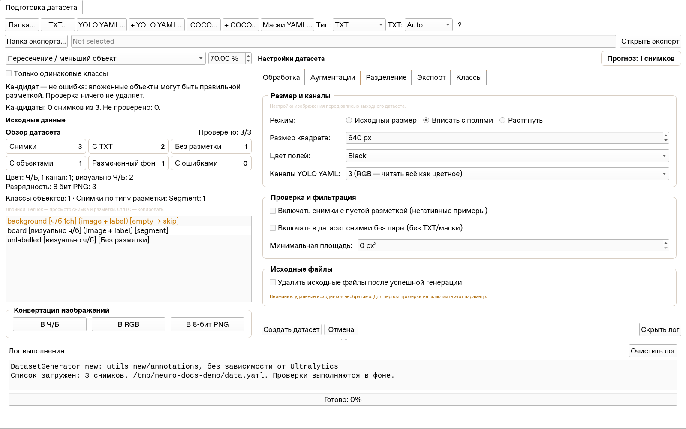
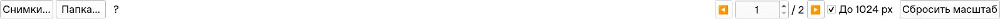

# Threshold‑Researcher

PyQt5-приложение для сегментации, разметки, подготовки датасетов и обучения моделей.
Настройки обучения разделены по этапам; [полные пресеты](docs/yolo_train.md#полные-пресеты-обучения)
задают параметры всех страниц и сохраняются в JSON.
Python 3.12. Выберите нужные вкладки при запуске; каждую можно открыть отдельно.



## Установка и запуск

Используйте отдельное окружение без глобальных пакетов:

```bash
python -m venv .venv
source .venv/bin/activate
python install.py
python dependency_health.py --load --cuda-test
python main.py
```

В Windows вместо `source` выполните `.venv\Scripts\activate`.
По умолчанию устанавливается **CUDA 13.0 (`cu130`)**, в том числе вместо уже
установленной CPU-сборки. Для RTX 5090 и обучения U-Net/DeepLab/SegFormer:

```powershell
python install.py --extra training
python dependency_health.py --load --torch-profile cu130 --cuda-test --extra training
```

Для NVIDIA GTX 1650 явно выберите профиль CUDA 12.6:

```powershell
python install.py --torch cu126 --extra training
python dependency_health.py --torch-profile cu126 --cuda-test
python main.py
```

| Профиль | PyTorch / torchvision | Назначение |
| --- | --- | --- |
| `cpu` | `2.11.0+cpu` / `0.26.0+cpu` | Без NVIDIA GPU, только явный `--torch cpu` |
| `cu126` | `2.11.0+cu126` / `0.26.0+cu126` | Основной вариант для GTX 1650 |
| `cu130` | `2.11.0+cu130` / `0.26.0+cu130` | По умолчанию; RTX 5090 и совместимые GPU/драйверы CUDA 13 |

Для готовых wheels нужен драйвер NVIDIA; отдельный CUDA Toolkit не требуется.
Без `--torch` установщик сохраняет текущий поддерживаемый **CUDA**-профиль.
В новом окружении и при установленном CPU-профиле выбирается `cu130`.
При ошибке установки/проверки CUDA автоматического перехода на CPU нет.
Для работы без NVIDIA GPU (включая macOS) явно используйте `python install.py --torch cpu`;
этот флаг нужно повторять при обновлениях и добавлении дополнений.

`pip install -r requirements.txt` также выбирает `cu130`. Для явного профиля доступны
`requirements/torch-cpu.txt`, `torch-cu126.txt` и `torch-cu130.txt`; все включают
общий `requirements/base.txt`, который отдельно устанавливать не следует.
После ручной установки восстановите OpenCV:
`python install.py --repair-opencv`.

В базу входят XGBoost и `pyamg` для Random Walker `cg_mg`. XGBoost работает на CPU
(`xgboost-cpu` на Windows/Linux); нейросети используют выбранный профиль PyTorch.
Установщик удаляет конкурирующий провайдер XGBoost и восстанавливает общие файлы.

| Дополнение `--extra` | Функции и библиотеки |
| --- | --- |
| `training` | U-Net/DeepLab/SegFormer: segmentation-models-pytorch, psutil |
| `audit` | ImageHash, OpenCLIP, Transformers, UMAP, HDBSCAN |
| `sahi` | Нарезка датасетов SAHI |
| `export` | Экспорт/применение ONNX и NCNN, TIFF: onnx, ncnn, pnnx, psutil, tifffile |
| `sam` | SAM/SAM2 и CLIP для SAM3 |
| `grounding-dino` | Grounding DINO через Transformers |

Флаги можно сочетать; `--extra all` устанавливает все эти дополнения, веса моделей
скачиваются отдельно. Версии — в [requirements](requirements/). Для обновления базы
достаточно `python install.py`: установленный CUDA-профиль сохраняется,
CPU обновляется командой `python install.py --torch cpu`.

```bash
python install.py --extra all
python dependency_health.py --load --extra all
```

Без `--extra` диагностика проверяет базу; с выбранными дополнениями — их версии,
источники Git и реальный импорт библиотек при `--load`. Отсутствующие дополнения
не считаются ошибкой базовой установки. Установщик проверяет именно выбранные профили.

Приложение использует один `opencv-python-headless`, окна создаёт PyQt5.
Требование Ultralytics/SAHI установить `opencv-python` — известное исключение метаданных.
При `WinError 5` на `cv2.pyd` закройте использующие окружение процессы Python.
При глобальных пакетах в `.venv` создайте окружение без **Inherit global site-packages**.
При `c10.dll` проверьте импорт Torch отдельно, драйвер и Visual C++ Runtime.
Повторный Python-import использует кеш; он не подменяет версию OpenCV.

## Вкладки

| Вкладка | Основная задача |
| --- | --- |
| [Пороговые методы](docs/threshold.md) | Бинаризация, морфология и автоподбор |
| [Градиентные методы](docs/gradient.md) | Границы, заполнение маски и автоподбор |
| [Интерактивные методы](docs/interactive.md) | Сегментация по рамке и меткам объекта/фона |
| [Традиционные методы ML](docs/traditional_ml.md) | Кластеризация и обучение классификаторов |
| [Deep Learning](docs/deep_learning.md) | YOLO, U-Net, DeepLab, SegFormer, ONNX/NCNN и SAM/SAM2/SAM3 |
| [Анализ отчётов](docs/reports.md) | Выбор методов по ручной эталонной разметке |
| [Добавить аннотации](docs/labeler.md) | BBox/OBB/Segment, Pose, Classification; авторазметка YOLO и SAM |
| [Просмотр аннотаций](docs/test.md) | Просмотр геометрии, Pose и классов снимка; маски и дубли |
| [Подготовка датасета](docs/dataset.md) | Отбор, аугментации, split и экспорт |
| [Анализ датасета](docs/dataset_analysis.md) | Качество, классы, повторы и утечки |
| [SAHI](docs/sahi.md) | Нарезка изображений вместе с разметкой |
| [Обучение модели](docs/yolo_train.md) | YOLO, U-Net, DeepLab, SAM/SAM2, AE/VAE, MAE/FCMAE; экспорт ONNX/NCNN |
| [Демонстрация результата](docs/yolo_demo.md) | YOLO, пороговые пресеты и ансамбль |
| [Сортировка с YOLO](docs/yolo_sort.md) | Поиск и отбор снимков по объектам |
| [YOLO + AE/VAE](docs/yolo_aeb.md) | Кропы, реконструкция и карта ошибок |
| [Настройки](docs/settings.md) | Тема, графика, классы и навигация |

Каждая инструкция содержит актуальный скриншот. Они сняты с текущего приложения
на демонстрационных данных; вид окна зависит от ОС, темы и масштаба.
Снимки интерфейса не подтверждают качество моделей. Новые веса U-Net/DeepLab/SegFormer
и ONNX-экспорты проекта содержат метаданные внутри файла; [форматы и ограничения
загрузки](docs/yolo_train.md#веса-результаты-и-метаданные) описаны отдельно.

## Общие действия

- Кнопки загрузки находятся в одной строке; скрытые при нехватке места — в **«Ещё…»**.
  **«Папка…»** читает снимки непосредственно в папке; рекурсивный поиск явно указан на вкладке сортировки.
- Перед импортом YAML/COCO откроется [проверка путей](docs/dataset.md): основной `path`,
  снимки, TXT/маски/JSON и счётчики. Подтвердите кнопкой OK; отмена сохраняет текущий набор.
- Обычный импорт заменяет набор. **«+ YOLO YAML…»** и **«+ COCO…»** на подготовке,
  анализе и SAHI добавляют данные с объединением классов по именам. Повторные снимки
  не дублируются; исходные TXT не изменяются.
- В поле навигации вводится только текущий номер; общее количество стоит рядом.
  Переход подтверждается Enter или выходом из поля.
- Просмотрщик и редактор читают снимки лениво. Импорт, проверка и статистика идут
  в фоне с прогрессом, отменой и повтором; смена набора отбрасывает устаревшие результаты.
- В подготовке датасета **пустая разметка** и **отсутствие TXT/маски** — разные случаи.
  Две независимые галочки их включения по умолчанию выключены. Прогноз split учитывает отбор.
- Морфология пяти вкладок методов задаётся в рабочих пикселях: закрытие, открытие,
  эрозия и расширение. BBox, OBB и Segment имеют те же форматы, что в редакторе датасета.
- SAM и интерактивные методы используют общие точки/штрихи и рамки: весь снимок,
  центр 50–90% ширины и высоты или рамка активного объекта. Объединение фрагментов
  создаёт общую рамку/выпуклую оболочку и не изменяет исходную маску.



SAM требует совместимых пакетов и локальных весов. В общем блоке можно скачать
недостающие файлы, затем нажать **«Загрузить SAM»**; зелёная кнопка означает готовность
с текущими параметрами. [Установка, веса, автономная работа и DINO](docs/deep_learning.md).
Загрузчик также подготавливает отдельные веса **SAM3.1 Object Multiplex**;
видеобэкенд этой модели пока не подключён к вкладкам применения.

## Разработка и утилиты

Одна вкладка: `python -m tabs.threshold_methods` из корня проекта.
Общий UI находится в `ui/`, алгоритмы и I/O — в `utils_new/`:

| Пакет | Назначение |
| --- | --- |
| `import_export/` | Снимки, YOLO/COCO/VOC/YAML, генерация и экспорт |
| `annotations/` | Геометрия, классы, маски, преобразования и сопоставление |
| `images/` | Предобработка, морфология, ограниченный кеш и диагностика |
| `dataset/`, `dataset_audit/` | Пары, проверка, статистика и аудит |
| `segmentation/` | Алгоритмы, модели, постобработка и метрики |
| `autoreseach_utils/` | Автоподбор, чтение и оценка отчётов |
| `autoencoders/`, `training/` | AE/VAE, процессы обучения и эксперименты |
| `configuration/` | Настройки, пресеты и параметры обучения |

Вычислительные утилиты не импортируют Qt. В `utils/` остаётся отдельный скрипт
списка файлов: `python utils/list_files.py "D:\dataset" "D:\results"`.
Экспериментальные скрипты кластеризации описаны в [cluster/README.md](cluster/README.md).

```bash
python -m unittest discover -s tests -v
NEURO_RUN_GUI_TESTS=1 QT_QPA_PLATFORM=offscreen python -m unittest discover -s tests -v
```

В PowerShell задайте переменные окружения через `$env:NEURO_RUN_GUI_TESTS="1"`
и `$env:QT_QPA_PLATFORM="offscreen"`. Эти проверки не заменяют Windows/CUDA и оценку
качества на ваших весах. [Оставшиеся планы](docs/PLAN.md).
Все иллюстрации и пример снимка с TXT находятся в [docs/image](docs/image/).
