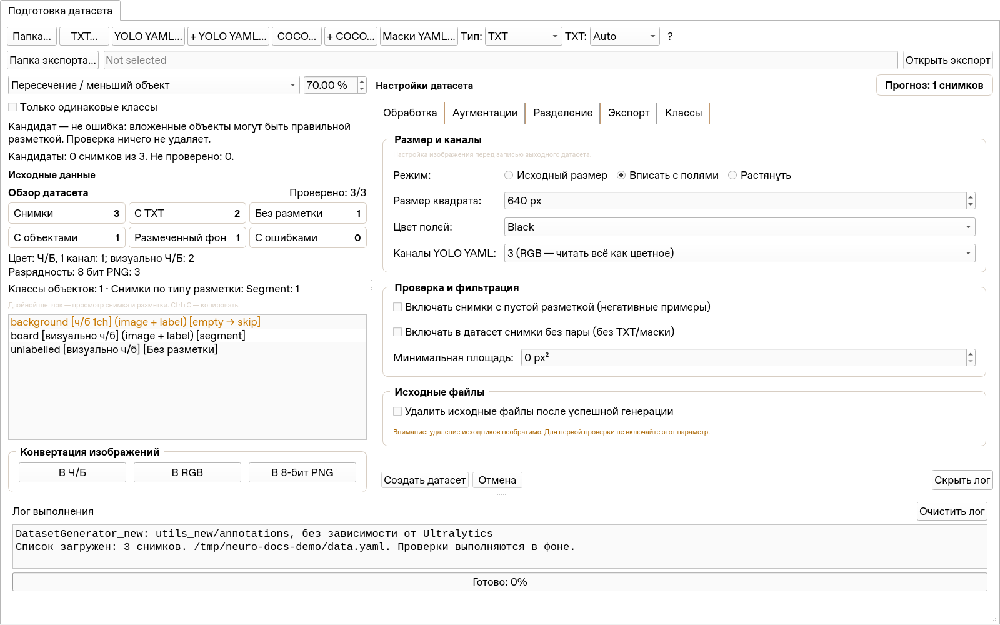
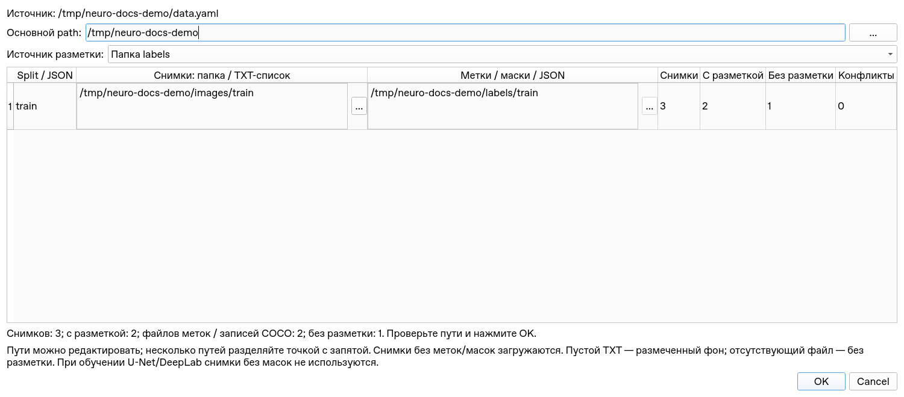
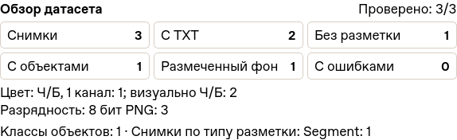

# Подготовка датасета

[README](../README.md)

Вход: папки снимков и TXT/масок, YOLO YAML, COCO или YAML с масками.

1. Выберите тип TXT / Маски / Без разметки и формат TXT при необходимости.
2. Загрузите набор; **«+ YOLO YAML…»** и **«+ COCO…»** добавляют данные,
   объединяя классы по именам. Проверьте снимки и классы.
3. Настройте размер/каналы, фильтры, аугментации и train/val/test.
4. Выберите выходы: YOLO TXT, индексные PNG-маски, YOLO/масочный YAML, COCO.
5. Укажите «Папка экспорта…», создайте датасет и проверьте несколько результатов.

Список появляется до завершения проверки. Проверка пар, поиск классов и свойства
снимков считаются в фоне; прогресс, отмена и повтор — внизу вкладки.
Генерация доступна после успешной проверки. Смена источника отменяет старую задачу.
В «Обзор датасета» отдельно указаны снимки, снимки с TXT/масками, без разметки,
с объектами, с размеченным фоном и с ошибками. Например, 200 снимков без TXT —
это 200 снимков и 0 с разметкой. Пустой TXT или нулевая маска — размеченный фон.
«Проверено» включает и корректные снимки, и ошибки; «—» означает, что проверка
ещё не закончена. Цветность, разрядность и найденные классы видны под счётчиками.

При добавлении YAML исходные TXT не меняются. Повторные снимки пропускаются,
а отсутствующая разметка может дополниться из добавляемого набора. Существующая
разметка сохраняется. TXT/COCO и индексные маски нельзя смешивать в одном наборе.
Выбранный формат TXT сохраняется; для разных видов разметки используйте Mixed,
учитывая неоднозначность четырёхточечного Segment и OBB в Auto/Mixed.
После конвертации в Ч/Б, RGB или 8-бит PNG список и статистика перепроверяются
в фоне, включая изменённые пути; привязка TXT сохраняется.

При выборе папки TXT учитываются подпапки, например `images/train` → `labels/train`.
Если точного пути нет, допускается единственное совпадение имени во вложенных папках;
при нескольких кандидатах укажите папку нужного split. Источник и число найденных
меток выводятся в лог. Выбранный формат TXT сохраняется при перезагрузке папок.

Для масок пиксели обозначают ID классов; фон — 0. COCO сохраняет маски через RLE,
включая отверстия и отдельные пиксели. Перевод масок в YOLO TXT теряет детали —
интерфейс предупреждает об этом. Выбор типа YOLO не меняет геометрию масок/COCO.
Для обучения Ultralytics OBB используйте «4 угла»; xywhr — формат обмена приложения.

Две независимые настройки отбора по умолчанию выключены:

- **Включать снимки с пустой разметкой** — пустые TXT и маски только с фоном.
- **Включать в датасет снимки без пары** — снимки, у которых нет TXT/маски.

Прогноз train/val/test учитывает обе настройки и исключает ошибки проверки.
При включении снимки без пары сохраняются без фиктивного TXT/маски; пустой TXT
или нулевая маска означают проверенный фон. В COCO это различается полем `annotation_status`.
Без разметки создаётся YAML с `dataset_type: images_only`, без фиктивных классов.
В этом отдельном режиме экспортируются все корректные снимки; обе галочки не применяются.

По умолчанию нужен новый экспорт. В «Если датасет уже существует» можно выбрать
добавление к совместимому результату (те же классы/форматы, manifest v2) либо
замену старого экспорта. Ошибка публикации восстанавливает предыдущие файлы.
YAML и COCO используют относительные пути: переносите всю папку результата.
Варианты одного исходника по умолчанию остаются в одном split; проценты при этом
приблизительные. Split с долей 0 остаётся пустым; для обучения нужна непустая val.
Удаление исходников — отдельная явная настройка; не включайте её для первой пробы.
