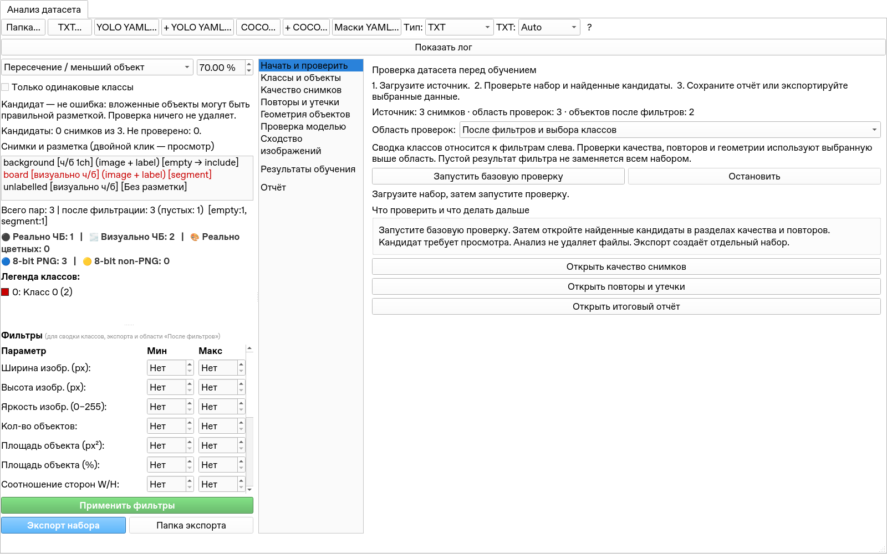

# Анализ датасета

[README](../README.md)

Вход и типы те же, что в подготовке: папки снимков/TXT/масок, YOLO YAML,
COCO с добавлением и YAML с индексными масками.
**«+ YOLO YAML…»** добавляет снимки и TXT к текущему набору с объединением классов
по именам; повторы не дублируются. Подробности — в [подготовке датасета](dataset.md).

1. Загрузите набор, проверьте классы и область анализа: весь набор либо фильтры.
2. В «Начать и проверить» запустите базовую проверку.
3. Откройте качество, повторы/утечки и геометрию; просмотрите отмеченные снимки.
4. Сохраните отчёт либо экспортируйте выбранный набор в отдельную папку.

Проверяются читаемость, размер, яркость, контраст/резкость, аннотации, повторы и split.
Порог качества настраивается; битые/пропущенные файлы не считаются благополучными.
Нейросетевой аудит требует весов/backend; для YOLO-валидации отдельно выбираются
папка или YAML. Результаты обучения читаются из папки run.
Загрузка списка, базовая проверка и фильтрация выполняются в фоне.
Прогресс, отмена и повтор — внизу вкладки; можно продолжать просмотр.
Новый набор отменяет старые расчёты. Анализ не удаляет оригиналы.
Утилиты анализа — `utils_new/dataset_audit`, интерфейс и контроллеры — `ui/dataset_audit`.

YOLO также загружает NCNN: выберите `.param` в папке `*_ncnn_model` рядом
с `.bin` и `metadata.yaml`. Нужен `--extra export`; GGUF пока не поддерживается.
[Экспорт и форматы моделей](yolo_train.md#экспорт-модели).
