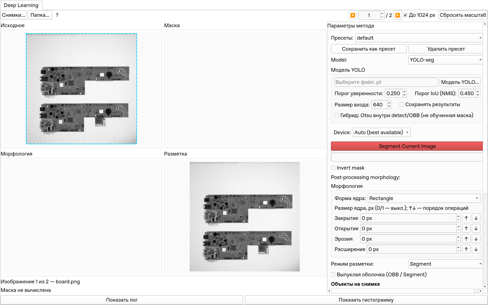
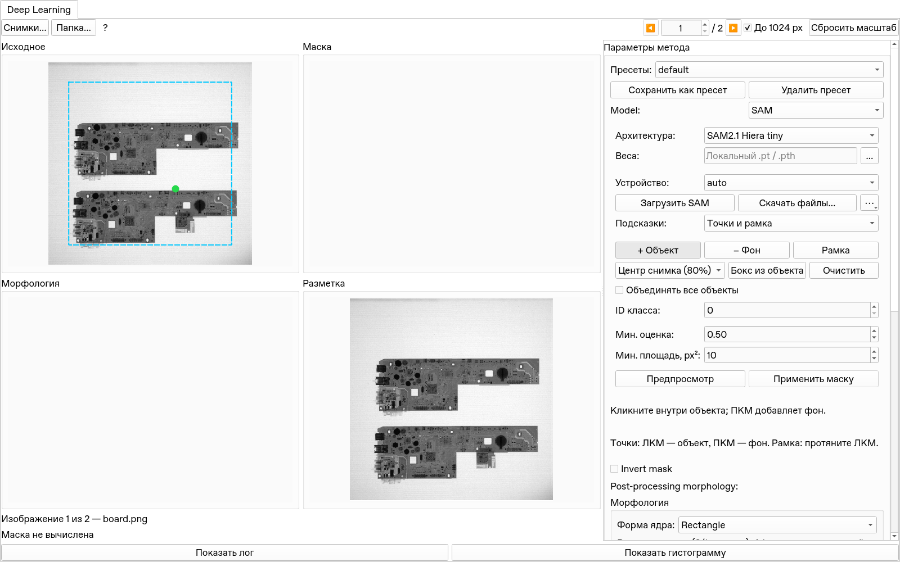

# Deep Learning: применение

[README](../README.md) · [Обучение](yolo_train.md)



1. Загрузите снимки или папку, выберите тип модели и совместимые локальные веса.
2. Укажите устройство, размер входа, нормализацию и порог/классы. Запустите обработку.
3. Проверьте маску, морфологию и список объектов; сохраните выбранные BBox/OBB/Segment.

YOLO принимает PT/ONNX/engine при наличии backend. U-Net/DeepLab используют
совместимые checkpoints и `*_meta.json` своего обучения. Custom ONNX ожидает
один RGB float32 NCHW-вход и один выход семантической сегментации с метаданными.
Detect/OBB + Otsu — отдельно включаемый гибрид. Общий результат — бинарная маска;
SegFormer пока не реализован. Алгоритмы — `utils_new/segmentation/backends/`.

## SAM, SAM2/2.1 и SAM3



1. Выберите **SAM**, архитектуру и устройство. Готовые веса подставляются при
   выборе архитектуры; отсутствующие можно скачать по предложению или **«Скачать файлы…»**.
2. Нажмите **«Загрузить SAM»**. Зелёная кнопка означает, что модель в памяти
   соответствует текущим весам, устройству и режиму. Смена этих параметров требует перезагрузки.
3. Выберите подсказки: точки/штрихи и рамку, текст SAM3 либо **«Текст + DINO (SAM2)»**.
   Короткий английский запрос предпочтителен; ID класса датасета задаётся отдельно.
4. **«Предпросмотр»** рисует голубые контуры. **«Применить маску»** принимает результат
   для текущего кадра; после этого доступны морфология, список объектов и сохранение TXT.

Свои дообученные SAM/SAM2 загружайте через обзор весов: `best.pt` и соответствующий
`best_meta.json` рядом. Архитектура выберется по метаданным; блок покажет эпоху и
val IoU/Dice по подсказкам. Без JSON архитектуру указывают вручную. Затем нажмите
**«Загрузить SAM»**; сохранённые веса самодостаточны. Подробности —
[данные, обучение и метрики](yolo_train.md#дообучение-sam--sam2).

ЛКМ добавляет объект, ПКМ — фон; зажатая кнопка рисует непрерывный штрих.
Область — весь снимок, центральные 50–90% **ширины и высоты**, своя рамка или
**«Бокс из объекта»**. Процент сохраняется при смене снимка; точки и ручная рамка очищаются.
Инструменты общие с [интерактивными методами](interactive.md) и [редактором](labeler.md).

Морфология применяется к маскам SAM отдельно. **«Объединять все объекты»** создаёт
общую BBox/OBB или выпуклую оболочку Segment, включая промежутки, без изменения маски
и повторного инференса. Фрагменты группируются до фильтра площади; для SAM её порог
проверяется по общей маске. Инверсия применяется к объединённой маске и выделяет фон.

Пресеты сохраняют параметры модели, пути, текст, пороги и объединение объектов.
Восстановление пресета не скачивает файлы и не загружает модель автоматически.
Загрузка и вычисления идут в фоне; смена снимка отбрасывает устаревший предпросмотр.

## Установка SAM и автономная работа

```bash
python install.py --extra sam --extra grounding-dino
```

SAM/SAM2 используют пакеты Meta; SAM3 — закреплённый Ultralytics и совместимый CLIP.
Официальный пакет `sam3` с `numpy<2` поверх окружения проекта не устанавливается.
В Windows для SAM2 можно заранее задать `$env:SAM2_BUILD_CUDA="0"`.
Пакеты и файлы модели — разные вещи: скачивание весов не устанавливает backend.

Для SAM3 с текстом нужен локальный `bpe_simple_vocab_16e6.txt.gz`.
Для SAM2 с текстом нужна полная папка Grounding DINO Transformers: safetensors,
конфигурация, препроцессор и токенизатор; одиночного `.pth` недостаточно.
DINO по умолчанию работает на CPU; пороги боксов/текста, NMS и лимит объектов
отделены от оценки маски SAM2. Все принятые объекты получают выбранный ID класса.

После подготовки пакетов, весов и вспомогательных файлов инференс работает локально.
Автоматической установки зависимостей во время применения нет. Сетевое скачивание
из UI запускается только после подтверждения. Требования к памяти проверяйте на своих весах.

## Скачивание весов SAM для локального применения

CLI работает на стандартном Python без PyTorch:

```bash
python -m utils_new.import_export.sam_weights --list
python -m utils_new.import_export.sam_weights --models sam sam2 sam3 --ask-token
python -m utils_new.import_export.sam_weights --models sam3 --weights-file "C:/models/SAM3.pt"
python -m utils_new.import_export.sam_weights --models sam3 --extras-only
python -m utils_new.import_export.sam_weights --models grounding-dino-tiny
```

По умолчанию — `models/segment_anything/`. `sam` означает ViT-B, `sam2` — SAM2.1 Tiny;
`all` скачивает все варианты SAM и не включает DINO. `--output` меняет папку,
`--dry-run` показывает план. Для готовых весов `--weights-file` использует файл на месте,
а вспомогательные ресурсы по умолчанию кладёт рядом. `--extras-only` пропускает веса.

SAM3 требует доступа к [facebook/sam3](https://huggingface.co/facebook/sam3): примите
условия и используйте скрытый ввод либо `HF_TOKEN`. Токен не сохраняется и не нужен,
если веса уже есть или скачивается только токенизатор. DINO доступен без токена.
`download_manifest.json` хранит SHA-256 для повторной проверки локальных файлов;
это не сверка с опубликованным автором хешем. Повреждённые файлы заменяются только
через `--force`; незавершённые удаляются. Переносите на автономный компьютер
весь комплект файлов и заранее подготовленное Python-окружение.
