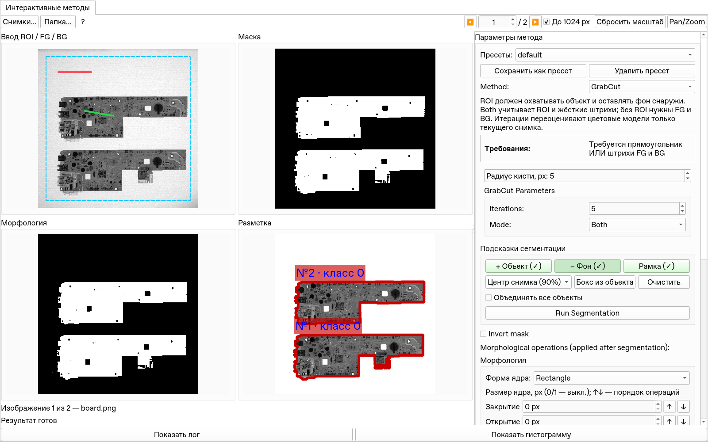

# Интерактивные методы

[README](../README.md)

Вход — снимки/папка; рамка и метки объекта/фона задаются на изображении.

1. Выберите алгоритм и прочитайте его требования к вводу.
2. В поле области выберите **«Весь снимок (100%)»** или **«Центр снимка (50–90%)»**.
   Процент относится к ширине и высоте: 50% — центральная половина по каждой оси.
   Можно нарисовать свою рамку или нажать
   **«Бокс из объекта»**, предварительно выбрав объект в списке/на результате.
   Кнопки **«+ Объект / − Фон»** добавляют точки; зажатая кнопка рисует непрерывный
   штрих. ПКМ рисует фон. Радиус кисти задаётся в рабочих px; Escape возвращает навигацию.
3. Запустите сегментацию, проверьте маску, примените морфологию и сохраните объекты.

GrabCut принимает ROI и/или штрихи; Random Walker — FG/BG; Active Contours и
Chan–Vese — ROI. Watershed имеет ручной и автоматический режимы.
Lazy Snapping, SuperCut и OneCut — варианты проекта, не точные реализации публикаций.
Инструменты и векторное отображение общие с SAM (`ui/segmentation/prompt_tools.py`,
`prompt_view.py`). Противоположный штрих заменяет прежнюю метку; **«Очистить»**
сбрасывает ввод; выбранный процент сохраняется и при смене снимка. Ручная рамка
после очистки заменяется на 100%. При начальной рамке на весь снимок
GrabCut, SuperCut, OneCut и Chan–Vese используют край снимка как начальный фон;
для объектов на краю уточните рамку или используйте метки FG/BG в подходящем методе.

**«Объединять все объекты»** даёт один объект в списке и при экспорте: общую
BBox/OBB либо выпуклую оболочку фрагментов Segment. Оболочка включает промежутки
между фрагментами; исходная маска не изменяется. Настройка сохраняется в пресете.
Маленькие фрагменты объединяются до индивидуального отсева по площади.

Undo/redo штрихов и рамки пока нет. Нейросетевые подсказки доступны в SAM на других вкладках. Импорт файла маски не предусмотрен.
Алгоритмы: `utils_new/segmentation/backends/interactive.py`.
