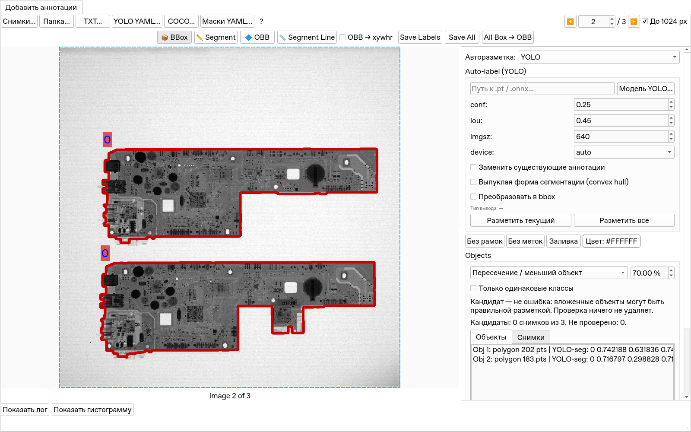
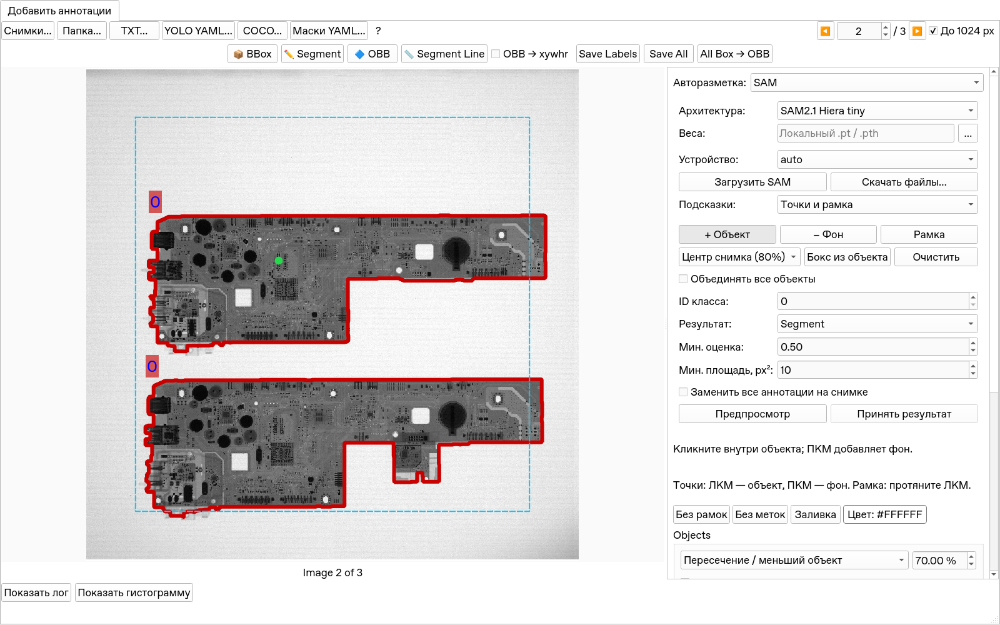

# Добавить аннотации

[README](../README.md)

Вход: снимки/папка, TXT, YOLO YAML, COCO или YAML с индексными масками.
Перед импортом проверьте пути и источник разметки. Маски преобразуются в полигоны
с возможной потерей отверстий и тонких деталей.

1. Выберите BBox, OBB, Segment или свободный Segment Line; создайте либо исправьте объект.
2. Назначьте класс. Ctrl+0…9 меняет класс выделенного объекта.
3. Для авторазметки выберите YOLO или SAM; сначала проверьте результат одного снимка.
4. **Save Labels** сохраняет текущую разметку, **Save All** — доступные загруженные/
   изменённые записи. Проверьте пути в подтверждении. **All Box → OBB** меняет геометрию в памяти.

Списки объектов и снимков показывают кандидатов на дублирование. Выберите IoU или
пересечение относительно меньшего объекта, процент и проверку класса.
Предупреждение не удаляет аннотации. При импорте COCO/масок Save пишет отдельные
YOLO TXT в постоянную папку `labels`; JSON и исходные маски не перезаписываются.

## Локальные SAM / SAM2 / SAM3

Установка, скачивание и автономная работа описаны в [Deep Learning](deep_learning.md).
Обе вкладки используют общий `ui/sam/`; точки, штрихи и рамки —
`ui/segmentation/prompt_view.py` и `prompt_tools.py`.

1. Выберите **SAM**, архитектуру, локальные веса и устройство. При отсутствии
   файлов используйте **«Скачать файлы…»**, затем **«Загрузить SAM»**.
   Зелёная кнопка означает готовность модели с текущими параметрами.
2. ЛКМ отмечает объект, ПКМ — фон; зажатая кнопка рисует линию, которая становится
   точками-подсказками модели. Противоположная метка заменяет прежнюю.
3. Задайте весь снимок, центр 50–90% ширины и высоты либо свою рамку.
   **«Бокс из объекта»** берёт рамку и класс активной аннотации.
   Текст доступен в SAM3 или SAM2/SAM2.1 с **Grounding DINO**; исходный SAM текста не поддерживает.
4. Выберите ID класса, Segment/BBox/OBB, минимальную оценку и площадь.
   **«Предпросмотр»** показывает голубой контур; **«Принять результат»** добавляет объекты.
   Замена всех аннотаций включается отдельно и подтверждается. Затем сохраните TXT.

**«Объединять все объекты»** создаёт общую рамку/выпуклую оболочку с промежутками
между фрагментами. Маска сохраняется, переключение не повторяет инференс.
Оценка SAM/SAM2 — предсказанный IoU; текстовый SAM3 и детектор DINO имеют другие оценки.
SAM не определяет ID классов вашего датасета автоматически.

Текущий снимок и соседи читаются лениво. Импорт, проверка и инференс работают в фоне;
навигация/отмена отбрасывают устаревший предпросмотр. Escape и ручные инструменты
отключают ввод подсказок. Выполняющийся вызов модели может завершаться в фоне.
