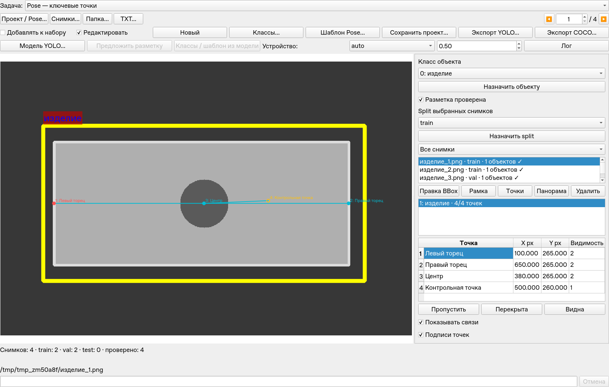
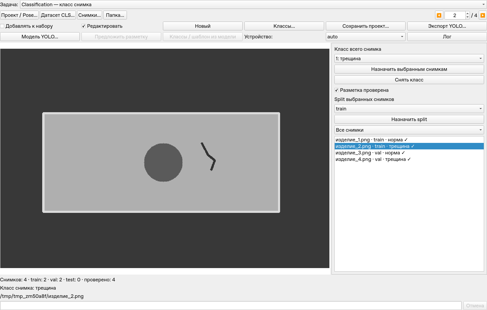

# Добавить аннотации

[README](../README.md)

Вход: снимки/папка, TXT, YOLO YAML, COCO или YAML с индексными масками.
Перед импортом проверьте пути и источник разметки. Маски преобразуются в полигоны
с возможной потерей отверстий и тонких деталей.

1. Выберите BBox, OBB, Segment или свободный Segment Line; создайте либо исправьте объект.
2. Назначьте класс. Ctrl+0…9 меняет класс выделенного объекта.
3. Для авторазметки выберите YOLO или SAM; сначала проверьте результат одного снимка.
4. **Save Labels** сохраняет текущую разметку, **Save All** — доступные загруженные/
   изменённые записи. Проверьте пути в подтверждении. **All Box → OBB** меняет геометрию в памяти.

Списки объектов и снимков показывают кандидатов на дублирование. Выберите IoU или
пересечение относительно меньшего объекта, процент и проверку класса.
Предупреждение не удаляет аннотации. При импорте COCO/масок Save пишет отдельные
YOLO TXT в постоянную папку `labels`; JSON и исходные маски не перезаписываются.

## Локальные SAM / SAM2 / SAM3

Установка, скачивание и автономная работа описаны в [Deep Learning](deep_learning.md).
Обе вкладки используют общий `ui/sam/`; точки, штрихи и рамки —
`ui/segmentation/prompt_view.py` и `prompt_tools.py`.

1. Выберите **SAM**, архитектуру, локальные веса и устройство. При отсутствии
   файлов используйте **«Скачать файлы…»**, затем **«Загрузить SAM»**.
   Зелёная кнопка означает готовность модели с текущими параметрами.
2. ЛКМ отмечает объект, ПКМ — фон; зажатая кнопка рисует линию, которая становится
   точками-подсказками модели. Противоположная метка заменяет прежнюю.
3. Задайте весь снимок, центр 50–90% ширины и высоты либо свою рамку.
   **«Бокс из объекта»** берёт рамку и класс активной аннотации.
   Текст доступен в SAM3 или SAM2/SAM2.1 с **Grounding DINO**; исходный SAM текста не поддерживает.
4. Выберите ID класса, Segment/BBox/OBB, минимальную оценку и площадь.
   **«Предпросмотр»** показывает голубой контур; **«Принять результат»** добавляет объекты.
   Замена всех аннотаций включается отдельно и подтверждается. Затем сохраните TXT.

**«Объединять все объекты»** создаёт общую рамку/выпуклую оболочку с промежутками
между фрагментами. Маска сохраняется, переключение не повторяет инференс.
Оценка SAM/SAM2 — предсказанный IoU; текстовый SAM3 и детектор DINO имеют другие оценки.
SAM не определяет ID классов вашего датасета автоматически.

Для своих дообученных весов выберите `best.pt`; сохраните рядом `best_meta.json`.
Общий блок определит архитектуру и покажет метрики полной эпохи. Нажмите
**«Загрузить SAM»**, задайте подсказку, затем **«Предпросмотр» → «Принять результат»**.
Без JSON архитектура выбирается вручную; исходные предобученные веса не нужны.
[Форматы данных и сохранения](yolo_train.md#входные-данные-и-хранение).

Текущий снимок и соседи читаются лениво. Импорт, проверка и инференс работают в фоне;
навигация/отмена отбрасывают устаревший предпросмотр. Escape и ручные инструменты
отключают ввод подсказок. Выполняющийся вызов модели может завершаться в фоне.

YOLO также загружает NCNN: выберите `.param` в папке `*_ncnn_model` рядом
с `.bin` и `metadata.yaml`. Нужен `--extra export`; GGUF пока не поддерживается.
[Экспорт и форматы моделей](yolo_train.md#экспорт-модели).

## Pose — свой набор ориентиров

В верхнем **«Задача»** выберите **Pose**. Режимы сохраняют независимые рабочие наборы:
переключение не превращает обычные рамки/полигоны в точки и не удаляет их.

1. **«Классы…»** задаёт классы объектов. **«Шаблон Pose…»** задаёт любое число
   точек, уникальные имена, связи и пары для зеркального отражения. Это не обязательно
   человек. Номера в диалоге — с 1; YAML `flip_idx` хранит индексы с 0.
2. Загрузите снимки/папку, Pose YAML или COCO Keypoints через **«Проект / Pose…»**.
   Для отдельных TXT сначала выберите шаблон, загрузите снимки, затем папку TXT.
   При YAML/COCO подтверждаются пути; источник записывается в **«Лог»**.
3. **«Рамка»** создаёт объект; **«Точки»** ставит ориентиры по порядку, позволяет
   перетаскивать их. **«Править рамку»** меняет BBox. Связи/подписи отключаются отдельно.
4. Таблица позволяет менять координаты и видимость: **0 — не размечена**, **1 —
   координата известна, но точка перекрыта**, **2 — видна**. Кнопки «Пропустить»,
   «Перекрыта», «Видна» переключают состояние. Ctrl+Z/Ctrl+Y — отмена/повтор для
   текущего снимка; Ctrl+0…9 назначает класс выбранному объекту.
5. **«Сохранить проект…»** сохраняет всю работу в JSON, включая шаблон и ссылки на
   снимки. **«Экспорт YOLO…»** создаёт новую папку images/labels и Pose YAML;
   **«Экспорт COCO…»** сохраняет рамки, точки, категории и связи.

Одна YOLO Pose-схема задаёт одинаковое число/порядок точек для всех объектов и классов.
Для несовместимых схем создавайте отдельные проекты. Число точек можно менять до
появления разметки; существующие точки автоматически не удаляются. По умолчанию
формат — `[N,3]` с видимостью. `[N,2]` не может сохранить пропущенные точки.
Нулевая координата видимой точки допустима; пропуск определяется видимостью.

**«Добавлять к набору»** объединяет классы по имени и проверяет конфликты.
Для COCO можно назначить split при загрузке; так добавляются отдельные train/val JSON.
Снимки без разметки не экспортируются как фон. Для пустого Pose-фона отметьте
«Разметка проверена» либо загрузите существующий пустой TXT. Пустые снимки из
COCO и снимки после удаления последнего Pose-объекта также сохраняются как фон;
это не означает, что импортированная разметка уже проверена вручную.

## Classification — класс снимка

1. Выберите **Classification**, задайте классы. Загрузите снимки/папку либо
   **«Датасет CLS…»**: корень train/val/test с папками классов или ещё не разделённые
   папки классов. Рабочий проект загружается через **«Проект / Pose…»**.
2. Выберите снимки в списке, класс и **«Назначить выбранным снимкам»**. Ctrl+0…9
   назначает класс; **«Снять класс»** возвращает «не размечен». Обычная YOLO-cls
   разметка содержит один класс снимка, без рамок. «Норма» — отдельный класс.
3. Назначьте выбранным снимкам train/val/test. Фильтры показывают класс,
   неразмеченные или непроверенные снимки. Изменение разметки снимает отметку проверки.
4. Сохраните JSON проекта либо экспортируйте в новые `train/<класс>`, `val/<класс>`,
   `test/<класс>`. Исходные файлы не перемещаются. Неразмеченные снимки исключаются;
   таблица переиндексации классов сохраняется в `class_mapping.json`.

Для обучающего экспорта нужны размеченные train и val; у каждого класса должны быть
снимки в train. Проверяются одинаковые файлы между split. Сканирование, чтение снимка,
сохранение и экспорт выполняются в фоне с отменой; все изображения заранее не читаются.
JSON проекта хранит пути, поэтому при переносе нужны сами снимки по этим путям.

В обоих режимах **«Модель YOLO…»** загружает соответствующую локальную модель.
**«Классы / шаблон из модели»** заполняет схему до начала разметки;
**«Предложить разметку»** выполняет инференс текущего снимка и запрашивает принятие
результата. Классы сопоставляются по имени; Pose проверяет число и известный порядок
точек. Порог предсказанных точек не является GT-видимостью. Модельные предложения
не отмечаются проверенными автоматически. [Обучение Pose/cls](yolo_train.md#yolo-pose-и-classification).
