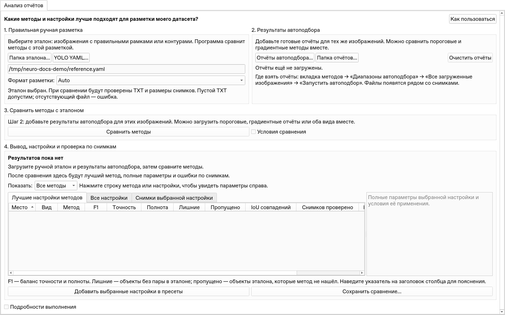

# Анализ отчётов

[README](../README.md)

Задача: определить методы и параметры, подходящие для разметки вашего датасета.

1. Загрузите правильную ручную разметку: YOLO YAML или папку снимков+TXT/только TXT.
   Для TXT без снимков размеры должны присутствовать в отчётах.
2. Добавьте готовые пороговые и градиентные отчёты файлами либо папкой рекурсивно.
   Их создаёт автоподбор на вкладках методов для тех же изображений.
3. Выберите формат эталона и IoU; нажмите «Сравнить методы».
4. Откройте лучшие настройки и ошибки по снимкам. Добавьте выбранные рецепты в
   пресеты нужных вкладок либо сохраните сравнение в отдельную пустую папку.

F1 оценивает баланс точности/полноты; FP — лишние объекты, FN — пропуски.
Победитель должен успешно покрывать весь эталон. Только отрицательные снимки
или неполные отчёты не позволяют выбрать лучший метод. Учёт классов включайте,
если ID результата и эталона совпадают. Проверьте победителя на новых снимках.
Экспорт: summary.md, CSV-таблицы и evaluation.json. Частичные отчёты не становятся
полноценным результатом; фильтры просмотра не меняют оценку.

На иллюстрации выбран эталон, но отчёты ещё не загружены. Пороговые и градиентные
автоотчёты должны относиться к этому же набору; обычные обучающие логи сюда не подходят.
