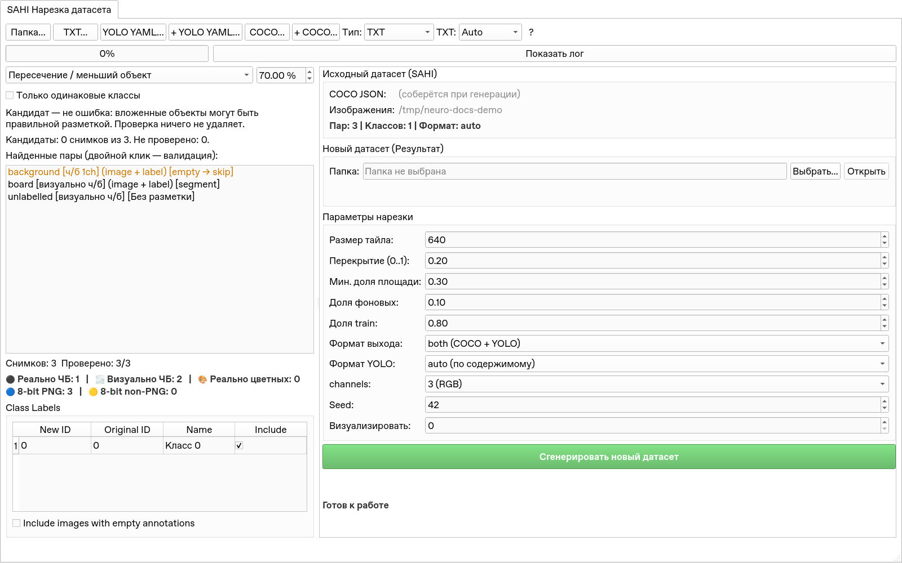

# SAHI: нарезка датасета

[README](../README.md)

Вход: папки снимков/TXT, YOLO YAML или COCO; **«+ YOLO YAML…»** и **«+ COCO…»**
добавляют набор с объединением классов по именам. Повторные снимки не дублируются.
Индексные маски входом не поддерживаются. Требуется extra sahi.

1. Загрузите разметку и проверьте пары/классы.
2. Задайте размер тайла, перекрытие, минимальную долю объекта, фоновые тайлы и split.
3. Выберите выход COCO/YOLO и формат геометрии, папку результата.
4. Создайте набор и проверьте несколько тайлов/аннотаций.

Загрузка, проверка пар и подготовка COCO для нарезки идут в фоне.
Прогресс, отмена и повтор — внизу вкладки. Дождитесь проверки перед запуском.

Выбирайте пустую папку: результат публикуется после завершения всех шагов.
Все тайлы одного исходного снимка остаются в одном split; доли приблизительные.
0% фона удаляет все проверенные фоновые тайлы. Снимки без разметки сохраняются
без YOLO TXT и не считаются проверенным фоном.
Нарезка полигонов и перевод в BBox меняют геометрию; маски RLE при переводе
в YOLO-полигоны теряют отверстия и тонкие детали. YOLO использует единый выбранный
тип и плотные ID классов; COCO и YAML содержат относительные пути.
