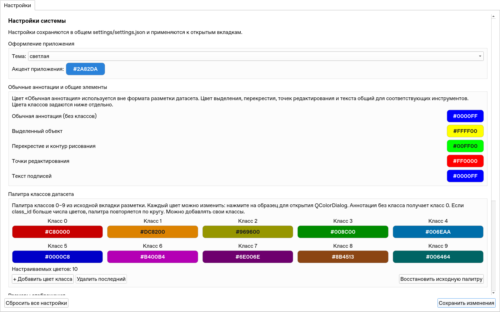

# Настройки

[README](../README.md)

Источников датасета нет. Здесь меняются тема, цвета классов, размеры шрифтов/
линий и сочетания навигации. Общие настройки применяются к открытым вкладкам.

Глобальные параметры хранятся в `settings/settings.json`, пресеты — в
`settings/presets/`, диапазоны автоподбора — в `settings/auto_settings/`.
Выбор вкладок и последние папки диалогов — отдельно в QSettings.

Текущая схема настроек — v1, пресетов пяти методов — v3 с морфологией в px.
Старые форматы не преобразуются автоматически; повреждённый файл не
перезаписывается при открытии. Для переноса настроек учитывайте файлы и QSettings.

В навигации текущий номер вводится отдельно от общего счётчика. Сочетания
клавиш относятся к активной вкладке; Num+4/Num+6 и обычные 4/6 различаются.
