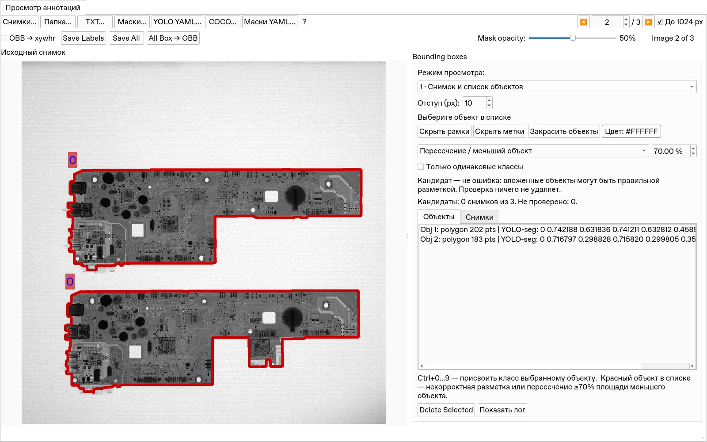
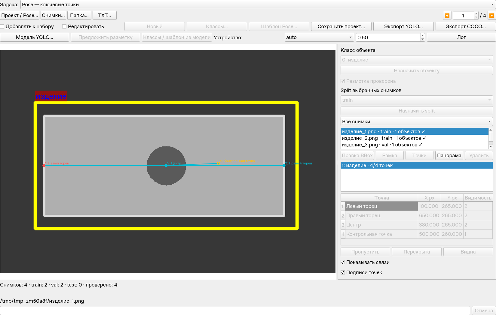

# Просмотр аннотаций

[README](../README.md)

Вход: снимки/папка, TXT, YOLO YAML, COCO, YAML с масками;
«Маски…» отдельно подключает индексные маски для наложения.

1. Загрузите снимки с разметкой; при необходимости подключите папки TXT/масок.
2. Настройте прозрачность маски, вид исходника/объектов, подписи и отступ кропа.
3. Просмотрите предупреждения в списках объектов и снимков; задайте метрику
   перекрытия, процент и проверку классов. Двойной клик/выбор снимка открывает кадр.
4. После правок сохраните текущую либо всю загруженную разметку с подтверждением путей.

TXT и маска наложения могут присутствовать одновременно. Масочный YAML при импорте
создаёт полигоны; это отличается от прямого наложения исходной индексной маски.
Перекрытие — кандидат для ручной проверки, а не команда удалить аннотацию.

После импорта COCO/масочного YAML Save сохраняет отдельные YOLO TXT в постоянную
папку `labels` исходного датасета; пути видны в подтверждении. Исходные JSON/маски
не перезаписываются. Временные контуры используются только для чтения до Save.

Чтение текущего снимка и соседей — ленивое, с ограниченным кешем. Импорт,
конвертация масок/COCO и проверка аннотаций идут в фоне с прогрессом и отменой.
Новый источник отменяет предыдущую загрузку; закрытие окна не ждёт чтения сети.

Поле навигации содержит текущий номер, общее количество показано рядом.
Сохранение меток и переключение снимка — разные действия.

## Просмотр Pose и Classification

В верхнем **«Задача»** доступны общие с редактором режимы **Pose** и
**Classification**. Загрузчики, схемы, списки, фильтры и экспорт одни и те же:
[порядок работы и форматы](labeler.md#pose--свой-набор-ориентиров).

Pose показывает BBox, именованные точки и связи произвольного шаблона, координаты
и видимость. Classification показывает класс снимка, split и статус проверки;
«не размечен» отличается от класса «норма». Для классификации используйте
**«Датасет CLS…»**, для Pose — YAML/COCO или проект. TXT требует выбранной схемы.

Режим просмотра открывается с выключенным **«Редактировать»**. Включите его для
исправлений, затем сохраните проект или выполните экспорт в новую папку.
Исходные TXT/COCO и снимки этими режимами не перезаписываются.
