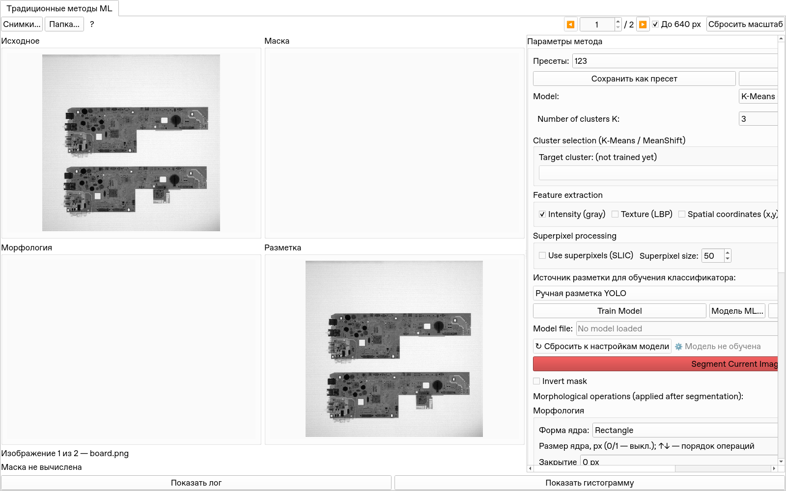

# Традиционные методы ML

[README](../README.md)

Вход — снимки/папка; модель — PKL/joblib.

1. Выберите KMeans/MeanShift либо SVM, Random Forest, Decision Tree, XGBoost.
2. Настройте признаки, нормализацию и суперпиксели.
3. Для классификатора выберите ручные YOLO TXT рядом со снимками/в labels либо
   явно включите псевдометки Otsu. Обучите модель; у кластеризации выберите кластер.
4. Примените модель к текущему кадру, проверьте маску и сохраните разметку.

Объекты TXT объединяются в foreground; отдельного импорта индексных обучающих
масок нет. При ресайзе рабочий предел — 640 px. Сохранение модели и разметки —
разные действия; при импорте модели согласуйте признаки с обучением.
Загружайте pickle/joblib только из доверенного источника. XGBoost входит в базовые
зависимости и загружается при обучении/чтении модели. На Windows/Linux используется
`xgboost-cpu`; при отсутствии пакета пункт отключён с подсказкой `python install.py`.
После обновления окружения перезапустите приложение.
Алгоритмы: `utils_new/segmentation/backends/traditional_ml.py`.

Расчёт запускается отдельно от сохранения TXT. Для сравнения с ручным эталоном
используйте независимые снимки; кластеризация не назначает семантические имена классов.
