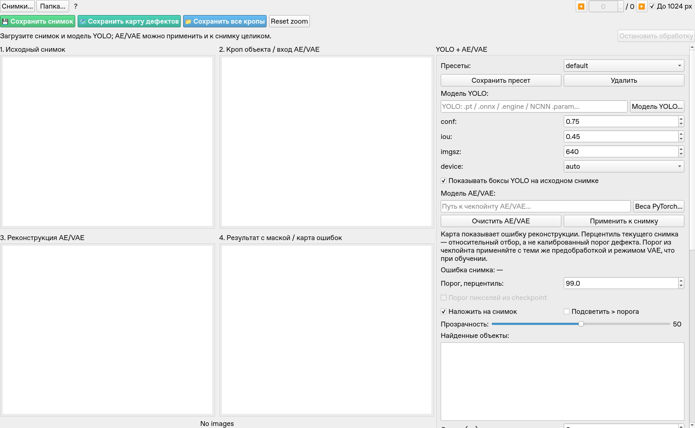

# YOLO + AE/VAE

[README](../README.md)



Вход: снимки/папка, отдельные веса YOLO и checkpoint AE/VAE.

1. Загрузите YOLO, выберите объект и параметры кропа/доворота.
2. Настройте преобразования и морфологию, проверьте обработанный кроп.
3. Загрузите AE/VAE и примените к кропу либо целому снимку.
4. Проверьте среднюю ошибку снимка и карту ошибок. Отдельно сохраните снимок, карту или кропы.

Карта показывает MAE реконструкции, а не вероятность дефекта. Новые checkpoint
содержат два порога: средней ошибки снимка и ошибки отдельных пикселей.
Оба считаются на нормальных снимках без padding. Превышение — кандидат для
проверки; качество отбора нужно оценить на отдельном наборе нормальных снимков и дефектов.
Перцентиль текущей карты — относительное выделение пикселей, он не заменяет калибровку.

Порог пикселей из checkpoint доступен только при наличии согласованной калибровки.
Старые веса четырёх архитектур загружаются с прежней предобработкой OpenCV;
их старый `threshold_value` не используется для маски. Новые модели используют
общую PIL-предобработку обучения и применения. Режим VAE хранится в checkpoint:
новое обучение использует среднее латентного распределения при оценке.
Для применения нужны те же кроп, масштаб, фон и предметная область, что при обучении.
Без AE/VAE остаются доступны YOLO, объекты и кропы.

Обучение доступно в **«Обучение модели → Обучение VAE/AE»** после экспорта моделей:
[форма, структура YAML и результаты](yolo_train.md#обучение-vaeae). CLI использует тот же тренер:

```bash
python -m utils_new.training.autoencoder --profile residual_ae --data "normal_images" --output "runs/ae_run" --device auto
```

Профили: `conv_bn_baseline`, `conv_bn`, `conv_gn`, `unet`, `unet_v2_edge_gan`, `residual_ae`, `residual_vae`,
`convnext_v2_ae`, `convnext_v2_vae`, `mae_vit_compact`, `fcmae_convnextv2`. Spatial-модели реконструируют через bottleneck
без U-Net skip-связей; профиль по умолчанию в UI и CLI — `residual_ae`.
Вместо `--profile` можно указать `--config settings/autoencoders/unet.json`.
Размеры и функции потерь задаются в JSON; `--epochs` и `--batch-size` переопределяют их.
Данные — папка нормальных снимков без дефектов или YOLO/MASKS YAML без требования
к меткам. Можно явно задать train/val/calibration/test; одинаковое содержимое
между split запрещено. TXT и маски не участвуют в обучении.
Результаты и кеш исключаются из входной папки. Для содержательного порога нужна
достаточная независимая val-выборка; одна-две фотографии дают ненадёжную оценку перцентиля.

Результат: `weights/best.pt` с калибровкой, `weights/last.pt` для возобновления,
`*_meta.json`, параметры, состав split, метрики, история и примеры реконструкции.
`Ctrl+C` сохраняет `weights/interrupted.pt`; незавершённая эпоха не заменяет `last.pt`.
Возобновление с последней полной эпохи:

```bash
python -m utils_new.training.autoencoder --data "normal_images" --output "runs/ae_run" --resume "runs/ae_run/weights/last.pt" --device auto
```

При resume проверяются параметры и содержимое датасета, восстанавливаются
оптимизаторы, scheduler, GAN и генераторы случайных чисел. Используйте то же
окружение и устройство; воспроизводимость CUDA зависит также от операций и драйвера.
`--no-plots` отключает графики, `--edge-cache` задаёт папку кеша рёбер.
Для нового обучения из готовых весов укажите `--initial-weights "runs/ae_run/weights/best.pt"`
и новую папку результатов; конфигурация модели должна соответствовать этим весам.
Общие модели, подготовка данных и обучение находятся в `utils_new/autoencoders/`;
чтение и запись checkpoint — в `utils_new/import_export/autoencoder.py`.

Снимки читаются через ограниченный кеш. Инференс, подготовка кропов и отмена
не должны применить результат к другому снимку после навигации.

YOLO также загружает NCNN: выберите `.param` в папке `*_ncnn_model` рядом
с `.bin` и `metadata.yaml`. Нужен `--extra export`; GGUF пока не поддерживается.
[Экспорт и форматы моделей](yolo_train.md#экспорт-модели).

MAE/FCMAE также загружаются из `weights/best.pt`. Они восстанавливают каждый patch
в скрытом состоянии за несколько детерминированных проходов; `mask_ratio` и seed
сохраняются в checkpoint. При выключенной калибровке нет готовых порогов аномалий.
Для предобучения по вашим снимкам из масочного YAML:

```bash
python -m utils_new.training.autoencoder --profile mae_vit_compact --data "dataset/masks_data.yaml" --output "runs/mae" --device auto
```

GT-маски объектов не используются при masked pretraining. Обучение сегментации
по ним остаётся отдельным сценарием U-Net/DeepLab. См. [параметры MAE/FCMAE](yolo_train.md#mae--fcmae).
