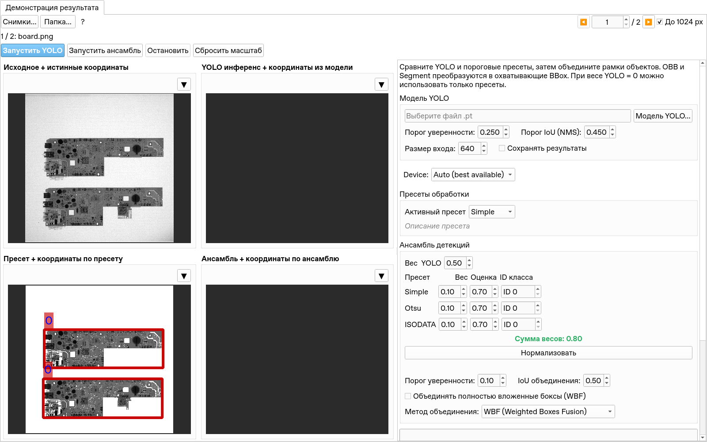

# Демонстрация результата и ансамбль

[README](../README.md)

Вход: снимки/папка, модель YOLO и существующие пороговые пресеты.
Соседние TXT используются как эталон для просмотра.

1. Загрузите снимки, модель и выберите пресеты.
2. Для каждого источника задайте вес; у пресета — оценку и class ID.
3. Запустите YOLO/ансамбль; сравните исходник, модель, пресет и объединение.

NMS/WBF объединяют BBox отдельно по классам. Нулевой вес исключает источник;
при весе YOLO 0 модель не нужна. Оценка пресета задаётся вручную и не является
вероятностью. Полигоны/OBB преобразуются в охватывающий BBox.
Четыре поля используют общую графику: колесо — масштаб, ЛКМ — панорамирование.

Вес YOLO 0 позволяет проверить ансамбль только пороговых пресетов. Снимок
на иллюстрации загружен без YOLO-весов; пустая панель модели не является результатом инференса.

YOLO также загружает NCNN: выберите `.param` в папке `*_ncnn_model` рядом
с `.bin` и `metadata.yaml`. Нужен `--extra export`; GGUF пока не поддерживается.
[Экспорт и форматы моделей](yolo_train.md#экспорт-модели).
