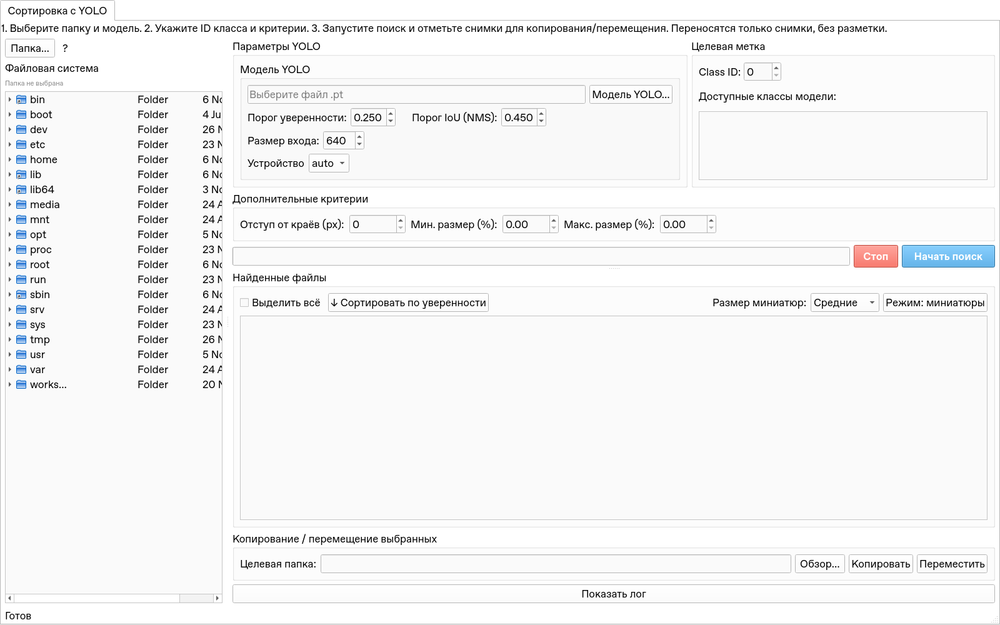

# Сортировка с YOLO

[README](../README.md)

Вход: корневая папка снимков, включая вложенные каталоги, и модель YOLO.

1. Выберите папку, загрузите модель и класс объекта.
2. Задайте conf/IoU, площадь объекта и отступы от краёв в исходных пикселях.
3. Запустите поиск, просмотрите результаты списком или миниатюрами.
4. Выберите снимки и отдельно задайте копирование/перемещение в целевую папку.

Обработка сохраняет исходную геометрию. Ошибки чтения видны в логе.
Переносятся только изображения: связанные TXT/маски автоматически не копируются.
Остановку поиска можно выполнить без применения поздних результатов.

Без загруженных совместимых весов поиск не выполняется. Проверьте целевую
папку перед перемещением: исходные изображения будут перенесены.
