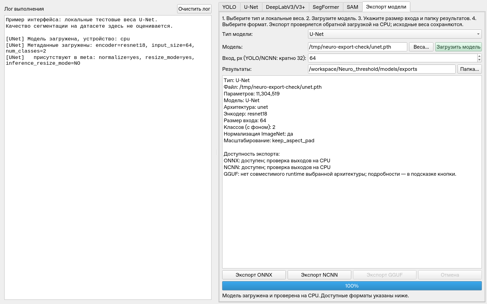
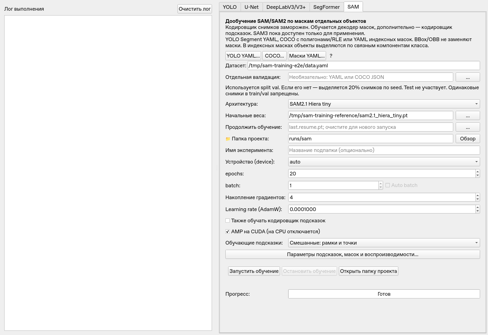

# Обучение модели

[README](../README.md) · [Применение](deep_learning.md)


YOLO принимает корень датасета/YOLO YAML; U-Net и DeepLab — корень или YAML
с индексными масками. DeepLab также поддерживает VOC. Требуется extra training
для U-Net/DeepLab. SAM/SAM2 поддерживают дообучение по маскам объектов;
обучение SAM3 и SegFormer пока не подключено.

1. Выберите архитектуру, источник данных, веса/backbone и число классов.
2. Задайте папку проекта/run, устройство, размер, epochs и batch.
3. Запустите обучение; следите за логом и метриками. Остановка завершает процесс.
4. Используйте checkpoints и метаданные текущего run; для применения сохраните
   те же нормализацию, классы и resize.

YOLO обучается из PT, не из ONNX/engine. AutoBatch — штатный механизм Ultralytics
на CUDA; OOM означает, что нужна меньшая нагрузка, а не повторный импорт библиотек.
Для ONNX установите `--extra export`. Экспорт YOLO выполняется на CPU с
`simplify=false`: упрощение onnxslim не используется, второй ONNX Runtime GPU
не требуется. Полученный граф проверяется через ONNX checker.
Базовые U-Net/DeepLab ожидают целые ID масок и согласованный фон/ignore_index;
U-Net считает число классов вместе с фоном. YAML имеет приоритет над полями.
DeepLab импортирует TXT-пресет «ключ: значение», веса классов — JSON-массив.

## Экспорт модели



После SAM находится вкладка **«Экспорт модели»**. Установите
`python install.py --extra export` (для U-Net/DeepLab также `--extra training`).
Выберите тип, локальные веса и **«Загрузить модель»**: появятся архитектура,
число параметров, классы, предобработка и доступные форматы. Зелёная кнопка
означает успешную проверку весов. Для U-Net/DeepLab рядом обязателен `*_meta.json`
с архитектурой, `input_size`, `normalize` и `resize_mode`.

Выберите размер входа (YOLO и NCNN — кратный 32), папку и **«Экспорт ONNX»** либо
**«Экспорт NCNN»**. Загрузка/экспорт идут в отдельном процессе с отменой и логом.
Результат публикуется в новой подпапке после загрузки runtime и сравнения выходов
с PyTorch на двух входах. Исходные веса и предыдущие экспорты не перезаписываются.
Это проверка преобразования, а не оценка качества на датасете.

| Модель | ONNX | NCNN | GGUF |
| --- | --- | --- | --- |
| YOLO PT: detect/segment/OBB/pose/classify | Штатный Ultralytics, opset 18 | Штатный Ultralytics + PNNX, FP32 | Нет совместимого backend |
| U-Net/U-Net++, DeepLabV3/V3+ проекта | Логиты + JSON, динамические H/W | PNNX, фиксированный размер, `.param` + `.bin` + JSON | Нет совместимого backend |
| SAM/SAM2/SAM3 | Нужен отдельный адаптер подсказок encoder/decoder | Нужен отдельный адаптер | Нет совместимого backend |
| Готовые ONNX/NCNN | Загрузка и информация; повторный экспорт из исходных PT/PTH | Загрузка и информация | Нет совместимого backend |

PNNX поддерживает не все операции/энкодеры. Если конвертер или проверка выходов
завершаются ошибкой, экспорт не публикуется. NCNN семантических моделей работает
на CPU, batch=1, FP32; сохраняется нормализация и геометрия исходной модели.
YOLO-экспорты загружайте в блоках YOLO, семантические — в **ONNX / NCNN**.
При переносе сохраняйте всю подпапку, включая метаданные.

Кнопка GGUF видна с объяснением и отключена. GGUF хранит тензоры, но не является
универсальным графом CNN; обычный llama.cpp не выполняет YOLO, U-Net или SAM.
Для подключения нужен конкретный экспортёр и runtime соответствующей архитектуры.
SegFormer и AE/VAE не имеют адаптеров экспорта в этом окне.

Документация форматов: [Ultralytics ONNX](https://docs.ultralytics.com/integrations/onnx/),
[Ultralytics NCNN](https://docs.ultralytics.com/integrations/ncnn/),
[PNNX](https://github.com/pnnx/pnnx), [GGUF](https://github.com/ggml-org/ggml/blob/master/docs/gguf.md).

## Дообучение SAM / SAM2



Установите backend: `python install.py --extra sam`. На вкладке **SAM** выберите
архитектуру и начальные локальные веса `.pt`/`.pth`; поиск начинается в `models/`.
Рекомендуемый первый запуск — **SAM2.1 Hiera tiny**, batch 1, AdamW, learning rate
`0.0001`, накопление градиентов 4. Кодировщик снимков всегда заморожен;
кодировщик подсказок можно обучать дополнительно. На CPU AMP отключается.
Это отдельный воркер, AutoBatch YOLO здесь не используется.

1. Загрузите **YOLO Segment YAML**, **COCO JSON** с полигонами/RLE или **YAML масок**.
   В окне импорта проверьте пути. BBox/OBB не заменяют маски; четырёхугольники TXT
   здесь явно читаются как Segment. В COCO сохраняются части объекта и отверстия RLE;
   crowd-аннотации отклоняются. В индексных масках каждый связный компонент класса —
   отдельный объект: соприкасающиеся объекты одного класса лучше задавать COCO/Segment.
2. Используется split `val`; при необходимости укажите отдельный YAML/COCO валидации
   (в отдельном YAML используется `val`, при его отсутствии — `train`).
   Если `val` отсутствует, 20% разных снимков **с объектами** выделяются по seed. `test` не участвует.
   Проверка SHA-256 не допускает одинаковые файлы снимков в train и val; копии внутри
   split с противоречащими масками отклоняются. Снимки без меток
   и пустые фоновые снимки не создают обучающих объектов и исключаются с записью в лог.
3. Выберите рамки, точки или смешанные подсказки. Они создаются из масок автоматически;
   в train рамки слегка смещаются, валидация воспроизводима. Ограничение числа объектов
   действует только в train; валидация проверяет все объекты.
4. Запустите обучение. В логе показаны проверка данных, шаги train/val и метрики;
   `best.pt` выбирается по среднему IoU объектов отдельной валидации. IoU/Dice измеряются
   при заданных подсказках и размере рабочих масок — это не метрика автоматического поиска.
5. Для применения выберите ту же архитектуру и `best.pt` в общем блоке SAM редактора
   или вкладки глубокого обучения. Дополнительная конвертация весов не нужна.

### Входные данные и хранение

SAM обучается выделять **один объект по подсказке**. ID классов в разметке нужны
для хранения датасета, но классификатор классов YOLO при таком обучении не появляется.
Рамки и точки создаются автоматически из целевых масок; хранить их отдельно не нужно.

| Источник | Где хранится разметка | Как определяется объект |
| --- | --- | --- |
| YOLO Segment YAML | `labels/train/name.txt`, `labels/val/name.txt` | Одна строка TXT — один полигон объекта |
| COCO JSON | Один JSON для train и отдельный JSON для val | Одна запись `annotations` — один объект, включая несколько частей |
| YAML индексных масок | Одноимённые PNG/TIFF в `masks/train`, `masks/val` | Связная компонента одного положительного pixel ID; связность 8 |

Обычная структура YOLO:

```text
dataset/
  data.yaml
  images/train/name.png
  images/val/another.png
  labels/train/name.txt
  labels/val/another.txt
```

```yaml
path: D:/dataset
train: images/train
val: images/val
names: [part]
```

TXT содержит `class_id x1 y1 x2 y2 ...`, координаты нормированы на ширину/высоту
снимка в диапазон 0–1, минимум три вершины. Например:
`0 0.1 0.2 0.7 0.2 0.7 0.8 0.1 0.8`. Строки BBox из пяти чисел непригодны.
Четырёхугольники здесь явно интерпретируются как маски Segment; по одним координатам
нельзя отличить их от OBB. Полигон TXT не хранит отверстия; для отверстий и нескольких
несвязных частей одного объекта предпочтителен COCO RLE.

В COCO нужны `images` с уникальными `id`, `file_name`, `width`, `height` и связанные
`annotations`: `id`, `image_id`, `category_id`, `iscrowd: 0`, `segmentation`.
`segmentation` — список полигонов в **пикселях** или RLE с `size: [height, width]`
и `counts` (массив либо сжатая строка). Части одного объекта объединяются;
перекрытия не вырезают дырки. Размеры должны совпадать с реальным снимком.

Пример YAML масок с теми же папками снимков:

```yaml
path: D:/dataset
train: images/train
val: images/val
train_masks: masks/train
val_masks: masks/val
num_classes: 2
class_names: [background, part]
mask_class_offset: 0
```

Маски — одноканальные целочисленные изображения тех же размеров, что снимок;
цветная визуализация разметки не подходит. По умолчанию `0` — фон, `255` —
игнорируемая область. **Для бинарных масок 0/255 выключите ignore ID: задайте -1
в дополнительных параметрах UI (`ignore_index: null` в JSON)**, иначе белые объекты
будут исключены. Более однозначный вариант — маски 0/1. Соприкасающиеся объекты
одного класса в такой маске сливаются; разные экземпляры лучше хранить в COCO/Segment.
Снимки приводятся к RGB uint8 общими утилитами проекта; uint16 делится на 256.
Максимальная сторона рабочих снимков/масок и правило обработки глубины должны
учитываться и при последующем применении.

### Веса и метрики

| Файл запуска | Содержимое и назначение |
| --- | --- |
| `best.pt` + `best_meta.json` | Полная модель лучшей эпохи по val IoU и метрики именно этой эпохи |
| `last.pt` + `last_meta.json` | Полная модель последней завершённой эпохи |
| `last.resume.pt` + `last.resume_meta.json` | Модель, оптимизатор, AMP, RNG, история, лучшие обучаемые параметры и подпись данных |
| `interrupted.pt` + `interrupted_meta.json` | Частичные веса при остановке; метрики этих весов не заявляются |
| `results.csv`, `history.json`, `metrics.json` | История по эпохам, лучший/последний результат и правила расчёта метрик |
| `params.json`, `dataset.json` | Параметры, фактические train/val снимки, формат и пути разметки/ID COCO |

SAM сохраняется как полный `state_dict`, SAM2 — как словарь с ключом `model`;
это не отдельный декодер/адаптер: исходные веса при применении не нужны.
JSON метаданных храните рядом с весами, с соответствующим именем. При выборе своих
весов через обзор общий блок SAM определит архитектуру по JSON и покажет эпоху,
val IoU/Dice и рабочую сторону. Без JSON выберите архитектуру вручную.
Если переименовали `best.pt` в `my_model.pt`, переименуйте JSON в `my_model_meta.json`.

`IoU = TP / (TP + FP + FN)`, `Dice = 2TP / (2TP + FP + FN)`. Метрики усредняются
**по объектам**, а не по всем пикселям датасета. Выбирается маска с максимальной
предсказанной оценкой IoU, не маска с лучшим совпадением с эталоном; порог логита — 0.
Ignore-пиксели исключаются. Валидация проверяет все объекты с воспроизводимыми
подсказками: рамка, точки либо оба варианта для смешанного режима. Порог score UI,
морфология и фильтр площади к этим метрикам не применяются.
Рамка валидации точно охватывает эталонный объект: эта оценка не обещает такое же
качество при подсказке **«Весь снимок»**. Для своего сценария проверяйте реальные клики/рамки.

Loss — минимум по трём кандидатам `BCE + soft Dice` плюс `0.1 × MSE` предсказанной
оценки IoU. Train-метрики считаются по выбранным объектам по мере обновления модели;
val — после эпохи на фиксированных весах. История содержит количество снимков,
объектов, шагов оптимизатора и пропусков AMP. Эпоха без шагов оптимизатора не засчитывается.
Эти оценки не являются mAP или оценкой автоматического поиска без подсказок.

**«Продолжить обучение»** принимает `last.resume.pt`: восстанавливаются оптимизатор,
генераторы случайных чисел, AMP и последняя полная эпоха. Поле epochs задаёт общее
число эпох, а не добавку. Разметка, снимки и параметры режима проверяются на изменения.
Сигнатура также учитывает версию подготовки масок: checkpoint продолжения старой
версии может потребовать нового запуска из `last.pt` после исправления растеризации.
Для изменения режима загрузите `last.pt` как начальные веса нового запуска.
Остановка посреди эпохи сохраняет `interrupted.pt` для применения, но не заменяет
checkpoint продолжения полной эпохи. При принудительном завершении процесса
частичные веса могут не сохраниться. Каждый запуск пишет в отдельную папку.
У частичных весов `metrics` пуст: результаты предыдущей полной эпохи хранятся
отдельно как `last_completed_metrics`. При продолжении они не выдаются за оценку
прерванных весов.

Максимальная сторона ограничивает рабочие снимки/маски; внутренний размер выбранной
SAM остаётся штатным. Поэтому уменьшение этого поля не гарантирует устранения OOM.
Возможность обучения на GTX 1650 нужно проверять на конкретных данных; начните с tiny,
batch 1 и замороженного кодировщика подсказок. SAM3 с текстом требует отдельного обучения.

CLI использует те же настройки:

```bash
python -m utils_new.training.sam --params_file sam_params.json
```

```json
{"model_key":"sam2.1-tiny","model_path":"models/segment_anything/sam2/sam2.1_hiera_tiny.pt","source":"dataset/data.yaml","project_path":"runs/sam","epochs":20,"device":"auto","accum_steps":4,"prompt_type":"mixed"}
```

Конфигурация — `utils_new/configuration/sam_training.py`, экземпляры объектов —
`utils_new/dataset/sam.py`, воркер — `utils_new/training/sam.py`, UI — `ui/sam/training.py`.

Проверены на CPU реальные SAM ViT-B и SAM2.1 tiny: обновление декодера и кодировщика
подсказок при неизменном кодировщике снимков, сохранение, независимый пересчёт IoU/Dice
по `best.pt` и загрузка/предпросмотр/принятие результата на обеих вкладках применения.
Для SAM2 также проверено совпадение обучения на одинаковых COCO RLE и индексных
масках, включая отверстия объектов.
Это синтетический контроль технического цикла; качество на вашем датасете и Windows/CUDA
проверяются отдельно. Повторить проверку с уже скачанными весами можно в PowerShell:

```powershell
$env:NEURO_RUN_GUI_TESTS="1"
$env:QT_QPA_PLATFORM="offscreen"
$env:NEURO_SAM_TEST_WEIGHTS="C:/models/sam2.1_hiera_tiny.pt"
$env:NEURO_SAM1_TEST_WEIGHTS="C:/models/sam_vit_b_01ec64.pth"
python -m unittest discover -s tests -p test_sam_training_roundtrip.py -v
```

Переменная весов включает проверки своей архитектуры; без неё модель пропускается.
Тесты ничего не скачивают и не изменяют входные веса.

## Остальные воркеры

Обучение AE/VAE запускается отдельным CLI: [профили, команды и калибровка](yolo_aeb.md).

Общие компоненты находятся в `utils_new/training/`, датасет снимок/маска —
в `utils_new/dataset/segmentation.py`, конфигурация — в `utils_new/configuration/training.py`,
сохранение весов и отчётов — в `utils_new/import_export/training.py`.

Запуск без интерфейса использует те же параметры JSON:

```bash
python -m utils_new.training.yolo --params_file yolo_params.json
python -m utils_new.training.unet --params_file unet_params.json
python -m utils_new.training.deeplab --params_file deeplab_params.json
```

Минимальный пример `unet_params.json`:

```json
{"dataset_path":"dataset","project_path":"runs/unet","encoder":"resnet18","input_size":256,"num_classes":2,"epochs":5,"batch_size":2,"device":"auto","pretrained":false}
```

`pretrained=false` отключает скачивание начальных весов. Для semantic AutoBatch
задайте `batch_size=-1`: на GPU выполняется пробный forward/backward, на CPU
используется небольшой batch. `plots=false` и `export_onnx=false` отключают
дополнительные артефакты. Остановка из интерфейса запрашивается через файл-маркер;
лучшие веса и последняя полная эпоха сохраняются, частичная — отдельно.
Кнопка папки открывает фактический каталог текущего запуска.

U-Net и DeepLab используют общий ресайз снимков и масок. Валидация не применяет
аугментации; `random_crop` использует центральный кроп при оценке. Метрики считаются
по общей матрице ошибок без хранения всех логитов. Веса `best_loss`, `best_iou` и
`last` имеют собственные метаданные; тестовые оценки относятся к указанному checkpoint.
Для продолжения обучения из весов задайте `model_path`; это загрузка весов,
а не восстановление состояния оптимизатора. Полный resume предусмотрен у AE/VAE.

Сетка экспериментов и экспорт VOC:

```bash
python -m utils_new.training.experiments --kind unet --grid grid.json --output experiments/run --limit 10
python -m utils_new.import_export.voc --yaml dataset/data.yaml --output exported
```

В `grid.json` значения — списки вариантов параметров; `--dry-run` сохраняет
конфигурации без обучения. Валидационные и тестовые метрики записываются раздельно.
VOC сохраняет индексные маски; `--binary-masks` явно объединяет положительные ID
в класс 1. В XML OBB/Segment становятся охватывающими BBox. Списки `ImageSets/Main`
содержат снимки с XML, `ImageSets/Segmentation` — только снимки с масками,
`ImageSets/All` — все снимки, включая неразмеченные. Экспорт учитывает подтверждённый
источник меток и создаёт переносимый `VOC/voc.yaml` с классами и путями.
Изображения сохраняются без перекодирования и потери глубины; стороннему ПО,
которое требует только JPEG в VOC, понадобится явная конвертация.
