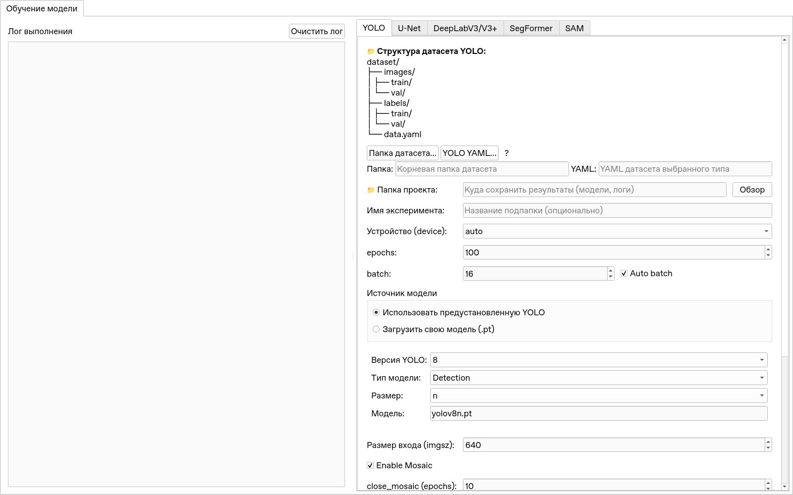

# Обучение модели

[README](../README.md) · [Применение](deep_learning.md)



YOLO принимает корень датасета/YOLO YAML; U-Net и DeepLab — корень или YAML
с индексными масками. DeepLab также поддерживает VOC. Требуется extra training
для U-Net/DeepLab. SAM и SegFormer — заготовки, обучение через них не работает.

1. Выберите архитектуру, источник данных, веса/backbone и число классов.
2. Задайте папку проекта/run, устройство, размер, epochs и batch.
3. Запустите обучение; следите за логом и метриками. Остановка завершает процесс.
4. Используйте checkpoints и метаданные текущего run; для применения сохраните
   те же нормализацию, классы и resize.

YOLO обучается из PT, не из ONNX/engine. AutoBatch — штатный механизм Ultralytics
на CUDA; OOM означает, что нужна меньшая нагрузка, а не повторный импорт библиотек.
Базовые U-Net/DeepLab ожидают целые ID масок и согласованный фон/ignore_index;
U-Net считает число классов вместе с фоном. YAML имеет приоритет над полями.
DeepLab импортирует TXT-пресет «ключ: значение», веса классов — JSON-массив.

Обучение AE/VAE запускается отдельным CLI: [профили, команды и калибровка](yolo_aeb.md).

Общие компоненты находятся в `utils_new/training/`, датасет снимок/маска —
в `utils_new/dataset/segmentation.py`, конфигурация — в `utils_new/configuration/training.py`,
сохранение весов и отчётов — в `utils_new/import_export/training.py`.

Запуск без интерфейса использует те же параметры JSON:

```bash
python -m utils_new.training.yolo --params_file yolo_params.json
python -m utils_new.training.unet --params_file unet_params.json
python -m utils_new.training.deeplab --params_file deeplab_params.json
```

Минимальный пример `unet_params.json`:

```json
{"dataset_path":"dataset","project_path":"runs/unet","encoder":"resnet18","input_size":256,"num_classes":2,"epochs":5,"batch_size":2,"device":"auto","pretrained":false}
```

`pretrained=false` отключает скачивание начальных весов. Для semantic AutoBatch
задайте `batch_size=-1`: на GPU выполняется пробный forward/backward, на CPU
используется небольшой batch. `plots=false` и `export_onnx=false` отключают
дополнительные артефакты. Остановка из интерфейса запрашивается через файл-маркер;
лучшие веса и последняя полная эпоха сохраняются, частичная — отдельно.
Кнопка папки открывает фактический каталог текущего запуска.

U-Net и DeepLab используют общий ресайз снимков и масок. Валидация не применяет
аугментации; `random_crop` использует центральный кроп при оценке. Метрики считаются
по общей матрице ошибок без хранения всех логитов. Веса `best_loss`, `best_iou` и
`last` имеют собственные метаданные; тестовые оценки относятся к указанному checkpoint.
Для продолжения обучения из весов задайте `model_path`; это загрузка весов,
а не восстановление состояния оптимизатора. Полный resume предусмотрен у AE/VAE.

Сетка экспериментов и экспорт VOC:

```bash
python -m utils_new.training.experiments --kind unet --grid grid.json --output experiments/run --limit 10
python -m utils_new.import_export.voc --yaml dataset/data.yaml --output exported
```

В `grid.json` значения — списки вариантов параметров; `--dry-run` сохраняет
конфигурации без обучения. Валидационные и тестовые метрики записываются раздельно.
VOC сохраняет индексные маски; `--binary-masks` явно объединяет положительные ID
в класс 1. В XML OBB/Segment становятся охватывающими BBox. Списки `ImageSets/Main`
содержат снимки с XML, `ImageSets/Segmentation` — только снимки с масками,
`ImageSets/All` — все снимки, включая неразмеченные. Экспорт учитывает подтверждённый
источник меток и создаёт переносимый `VOC/voc.yaml` с классами и путями.
Изображения сохраняются без перекодирования и потери глубины; стороннему ПО,
которое требует только JPEG в VOC, понадобится явная конвертация.
